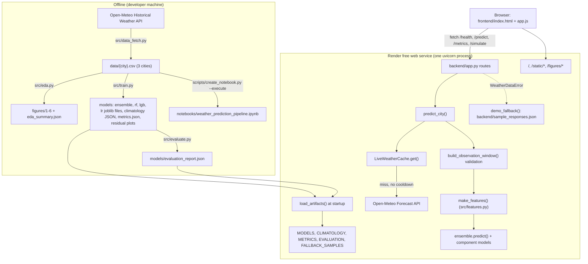

# ML Weather Predictor — Project Deep Dive

A complete technical guide to the project: how the data were prepared, how the models work and were evaluated,
how the web service behaves (including its failure modes), and how to explain and demonstrate all of it in a viva.

**Sources and conventions**
- Every number and behaviour here was checked against the repository at commit `c5e8b7c` (26 Oct 2026). Results
  come from `models/metrics.json` and `models/evaluation_report.json`, both reproduced from the saved models.
- Where a statement could not be verified, it is labelled **(not verified)**.
- Example values marked **(illustrative)** were not captured from a real response.

| Status label | Meaning |
|---|---|
| **Verified** | Checked by running code, tests or the deployed service during the audit |
| **Implemented, not independently verified** | The code exists and is reasonable, but it was not exercised in the audit |
| **Known limitation** | Behaviour is as designed but limits what the project can claim |

---

## Contents
- [Chapter 1: Project overview](#chapter-1-project-overview)
- [Chapter 2: End-to-end architecture](#chapter-2-end-to-end-architecture)
- [Chapter 3: Data sources and data preparation](#chapter-3-data-sources-and-data-preparation)
- [Chapter 4: Exploratory data analysis](#chapter-4-exploratory-data-analysis)
- [Chapter 5: Feature engineering](#chapter-5-feature-engineering)
- [Chapter 6: ML theory and model implementation](#chapter-6-ml-theory-and-model-implementation)
- [Chapter 7: Model training and experimentation](#chapter-7-model-training-and-experimentation)
- [Chapter 8: Evaluation and interpretation](#chapter-8-evaluation-and-interpretation)
- [Chapter 9: Backend and API implementation](#chapter-9-backend-and-api-implementation)
- [Chapter 10: Live data, cache and rate limits](#chapter-10-live-data-cache-and-rate-limits)
- [Chapter 11: Frontend and dashboard](#chapter-11-frontend-and-dashboard)
- [Chapter 12: Testing and quality assurance](#chapter-12-testing-and-quality-assurance)
- [Chapter 13: Setup, execution and deployment](#chapter-13-setup-execution-and-deployment)
- [Chapter 14: Limitations, risks and future work](#chapter-14-limitations-risks-and-future-work)
- [Chapter 15: Viva preparation](#chapter-15-viva-preparation)
- [Chapter 16: Live demonstration script](#chapter-16-live-demonstration-script)
- [Chapter 17: File-by-file code navigation](#chapter-17-file-by-file-code-navigation)

---

## Chapter 1: Project overview

### 1.1 Motivation and problem statement
Daily maximum temperature drives heat-stress risk, electricity demand and many everyday decisions in Indian cities.
Official numerical weather prediction (NWP) already forecasts it, so the useful question for a data-science project
is not "can we beat a supercomputer" but:

> Given only the last seven completed days of four daily variables at one location, how well can classical machine
> learning predict tomorrow's maximum temperature, compared with trivial forecasts, and can it state its uncertainty
> honestly?

### 1.2 Intended users and use cases
- **Students and examiners:** a complete, reproducible ML pipeline with honest evaluation.
- **Dashboard visitors:** one city at a time, seeing the model's prediction for tomorrow, its uncertainty, how it
  compares with baselines, and the official forecast for reference.

### 1.3 Scope and non-goals
| In scope | Non-goals |
|---|---|
| Bengaluru, Delhi, Mumbai | Other cities or spatial interpolation |
| Daily max temperature at 2 m, target D+2 | Rain, minimum temperature, hourly forecasts, multi-day horizons |
| 2019–2023 data; 2023 held out | Continuous retraining, monitoring, drift detection |
| Persistence and climatology baselines | Beating or replacing official NWP forecasts |
| Empirical 80% interval with measured coverage | Fully calibrated probabilistic forecasting |
| FastAPI + static dashboard on Render | User accounts, authentication, persistent storage |

### 1.4 Inputs, outputs and assumptions
- **Input (per request):** the city name. The backend then fetches the last 10 days plus a 4-day forecast from
  Open-Meteo and uses only the 7 completed days D−6 … D.
- **Output:**
  - the ensemble's predicted max temperature for D+2;
  - an 80% interval;
  - both baselines and each component model's prediction;
  - the official forecast for the target date and current conditions (reference only);
  - the LightGBM component's TreeSHAP contributions;
  - the 7 input days.
- **Assumptions:**
  - live Forecast-API values for past days are close enough to the reanalysis data used for training (spot-checked
    only, [§3.7](#37-training-data-vs-live-data));
  - future errors resemble 2019–2022 out-of-fold errors (the basis of the interval);
  - the climate in 2026 resembles 2019–2022 (2023 already deviated).

---

## Chapter 2: End-to-end architecture

### 2.1 Architecture diagram



### 2.2 Data flow (offline)
1. **`src/data_fetch.py`** downloads daily data for 2019-01-01 … 2023-12-31 for three coordinates and writes
   `data/{city}.csv`.
2. **`src/eda.py`** writes figures 1–5 and `figures/eda_summary.json`. `plot_memory_diagnostics()` writes figure 6.
3. **`src/train.py`**, per city:
   - climatology from training years;
   - `make_features()`;
   - chronological split;
   - hyperparameter search (RF, LightGBM) with `TimeSeriesSplit(5)`;
   - out-of-fold (OOF) predictions;
   - ensemble weights;
   - interval offsets;
   - final refit;
   - test-year metrics;
   - residual plots;
   - joblib files and `metrics.json`.
4. **`src/evaluate.py`**, without retraining, recomputes the test metrics from the saved models and measures the
   served interval's coverage. It re-runs the CV folds for validation MAE and writes `evaluation_report.json`.
5. **`scripts/create_notebook.py --execute`** builds and executes the notebook from the project's own functions.

### 2.3 Runtime flow for one `/predict` request

```mermaid
sequenceDiagram
    participant B as Browser (app.js)
    participant A as FastAPI /predict
    participant C as LiveWeatherCache
    participant O as Open-Meteo Forecast API
    participant M as Features + models
    B->>A: GET /predict?city=Delhi
    A->>A: resolve_city() (400 if unknown), require_ready() (503 if models missing)
    A->>A: forecast_dates(ist_now()) gives D and target = D+2 (IST)
    A->>C: get((delhi, D, 10, 4), fetch, validate)
    alt valid entry younger than 30 min
        C-->>A: cached payload (from_cache = true)
    else cooldown active after HTTP 429
        C-->>A: WeatherDataError("rate_limited")
    else
        C->>O: GET /v1/forecast (past_days=10, forecast_days=4, timeout 10 s)
        O-->>C: JSON or HTTP error
        C->>C: validate (D-6..D present and numeric) and store if valid
        C-->>A: payload (from_cache = false) or WeatherDataError
    end
    alt payload available
        A->>M: build_observation_window(), make_features(), predict
        M-->>A: ensemble + components, interval, SHAP
        A-->>B: 200 JSON, data_source = "live" or "live_cached"
    else WeatherDataError
        A-->>B: 200 demo snapshot, is_demo_fallback = true, fallback_reason
    end
    B->>B: render cards; show banner if is_demo_fallback
```

### 2.4 Component map
| Component | Path | Responsibility | Inputs → outputs | Used at runtime? |
|---|---|---|---|---|
| Data download | `src/data_fetch.py` | Fetch historical data; defines `CITIES`, `DAILY_VARIABLES` | Archive API → CSV | Constants yes, download no |
| EDA | `src/eda.py` | Figures, summary JSON, `assign_season()` | CSV → PNG, JSON | No (`assign_season` used by training and evaluation) |
| Features | `src/features.py` | `make_features()`, `seasonal_features()`, `compute_climatology_map()`, constants | DataFrame → feature DataFrame | **Yes** |
| Ensemble | `src/ensemble.py` | `StackingEnsemble` (needed to unpickle the ensemble) | 3 models + weights → prediction | **Yes** |
| Training | `src/train.py` | Full training pipeline | CSV → models, metrics, plots | No |
| Intervals | `src/intervals.py` | `interval_bounds()`, coverage functions | prediction, p10, p90 → bounds | **Yes** (and in evaluation) |
| Evaluation | `src/evaluate.py` | Re-evaluation of saved models | models, CSV → `evaluation_report.json` | No (its output is served) |
| API | `backend/app.py` | Routes, artifact loading, `predict_city()`, demo fallback, static files | HTTP → JSON/HTML | **Yes** |
| Live data | `backend/live_data.py` | IST dates, fetch, validation, `LiveWeatherCache` | Forecast API → validated window | **Yes** |
| Snapshots | `backend/sample_responses.json` | Demo responses captured 25 Oct 2026 | — | **Yes** (fallback only) |
| Dashboard | `frontend/*` | UI | API JSON → page | **Yes** |
| Streamlit | `streamlit_app.py` | Alternative UI calling `backend.app` functions directly | — | Not deployed |
| Entry point | `main.py` | Local launcher (uvicorn + browser) | — | Local only; Render calls uvicorn directly |
| Notebook tools | `scripts/create_notebook.py` | Build and execute the notebook | — | No |
| Snapshot tool | `scripts/capture_demo_snapshots.py` | Refresh snapshots from a real run | — | No |

### 2.5 External dependencies and failure boundaries
| Boundary | Failure | Behaviour (verified by tests) |
|---|---|---|
| Open-Meteo Forecast API | Timeout (> 10 s) | `timeout` → demo snapshot |
| | Connection error | `upstream_error` → demo snapshot |
| | HTTP 429 | `rate_limited` → demo snapshot; cooldown for all cities |
| | Other HTTP ≥ 400 | `upstream_error` → demo snapshot |
| | Invalid JSON or schema | `malformed_response` / `missing_variable` → demo snapshot |
| | Missing or non-numeric day in D−6 … D | `insufficient_history` / `missing_values` → demo snapshot (never a silently shifted window) |
| Model files | Missing or unloadable | `/health` 503; `/predict` 503 (never demo mode) |
| Demo snapshots | File missing and live data fails | `/predict` 503 with the reason |
| Application bug | Any other exception in the pipeline | `/predict` 500 "Internal prediction error"; details only in the server log |
| Render free tier | Sleep after inactivity | Slow first request; in-memory cache emptied |

---

## Chapter 3: Data sources and data preparation

### 3.1 Origin and format
- **Source:** Open-Meteo Historical Weather API (`https://archive-api.open-meteo.com/v1/archive`), called by
  `fetch_city_history()` with `timezone=Asia/Kolkata`, so each row is a local Indian calendar day.
- **Files:** `data/bengaluru.csv`, `data/delhi.csv`, `data/mumbai.csv`, committed to the repository. Re-running
  `python -m src.data_fetch` overwrites them.
- **Period:** 2019-01-01 to 2023-12-31; **1826 rows per city** (2020 is a leap year).
- **Coordinates:** Bengaluru (12.9716, 77.5946), Delhi (28.6139, 77.2090), Mumbai (19.0760, 72.8777). Each is a
  single model grid point near the city centre, not a weather station.

### 3.2 Data dictionary
| Column | Meaning | Unit | Notes |
|---|---|---|---|
| `date` | Local calendar day (IST) | YYYY-MM-DD | Consecutive, no gaps or duplicates (verified) |
| `temperature_2m_max` | Daily maximum air temperature at 2 m | °C | **The target variable** (shifted by 2 days) and the main predictor |
| `relative_humidity_2m_mean` | Daily mean relative humidity at 2 m | % | Integer values |
| `wind_speed_10m_max` | Daily maximum wind speed at 10 m | km/h | |
| `precipitation_sum` | Daily total precipitation | mm | Heavily right-skewed; mostly 0 |
| `city` | City name | — | Not used as a feature (one model set per city) |

Summary statistics (from `figures/eda_summary.json`):

| | Bengaluru | Delhi | Mumbai |
|---|---|---|---|
| Mean daily max (°C) | 28.8 | 30.2 | 30.4 |
| Std of daily max (°C) | 2.9 | 7.0 | 2.5 |
| Min / max of daily max (°C) | 18.5 / 37.1 | 12.9 / 45.4 | 23.1 / 38.7 |
| Days per year with max ≥ 35 °C | 6 | 93 | 12 |
| Days per year with max ≥ 40 °C | 0 | 25 | 0 |
| Max daily precipitation (mm) | 73.4 | 125.4 | 200.7 |

### 3.3 Cleaning and missing values
- **No missing values, no missing dates and no duplicate dates** in any city (verified by recomputation), so no
  imputation, interpolation or row removal was needed.
- **`make_features()` refuses non-consecutive data.** It raises `ValueError` if dates are not consecutive (a gap or a
  duplicate). Lags are row shifts, so a gap would silently misalign every lag.
- **Rows dropped at the edges:** rows whose features or target are undefined (the first 6 days and the last 2) are
  dropped. That leaves 1818 rows per city: 1453 for training and 365 for testing.

### 3.4 Scaling, encoding and normalisation
- **No scaling.** Tree models do not need it. Ridge is fitted on unscaled features; a re-check showed scaling changes
  Ridge's validation MAE by only 0.003–0.020 °C.
- **No categorical encoding**, because each city has its own models.
- **Season of the year** is encoded cyclically by sine/cosine features ([Chapter 5](#chapter-5-feature-engineering)).

### 3.5 Date and timezone conventions
- **Training data:** dates are local (IST) days from the API.
- **At runtime, `backend/live_data.py` never trusts the server clock**, because cloud servers usually run in UTC:
  - `ist_now()` converts the current UTC time to IST (fixed UTC+05:30; India has no daylight saving);
  - `forecast_dates(now)` returns `D = today_IST − 1` and `target = D + 2`;
  - it rejects naive (timezone-less) datetimes.
- **Verified example:** on the deployed server, `/health` returned `timestamp_ist` 03:24 IST on 26 Oct 2026. A forced
  UTC clock of 19:30 UTC on 24 Oct (01:00 IST, 25 Oct) produced D = 24 Oct and target = 26 Oct.

### 3.6 Train / validation / test split
| Set | Definition | Rows per city |
|---|---|---|
| Training | Rows whose **target date** is before 2023-01-01 | 1453 |
| Validation | 5-fold `TimeSeriesSplit` inside the training rows (expanding window) | 5 × 242 = 1210 OOF rows |
| Test | Rows whose target date is in 2023 | 365 |

`TimeSeriesSplit(n_splits=5)` on 1453 rows makes 5 validation blocks of 242 consecutive rows. Fold *k* trains on
everything before its block (first fold: 243 rows). The first 243 rows are never validated, so OOF covers 1210 rows.

**Leakage controls (verified)**
- **No feature uses data after D.** `test_no_data_leakage` deletes future rows and checks the features are unchanged.
- **The climatology baseline uses training years only** (`test_climatology_ignores_test_year`).
- **The split is chronological**, and the test year was used only for final scoring. Hyperparameters, blend weights
  and interval offsets come from training-year folds only.
- **Fold boundaries:** the last training rows of a fold have targets T(t+1), T(t+2), which later appear as lag
  features of the first validation rows. That is legitimate: they would be known at forecast time. No validation
  target appears in training.

**Remaining validity caveats**
- **The OOF predictions are reused**, so the ensemble's validation MAE is slightly optimistic. The same OOF
  predictions were used to pick hyperparameters (3 settings each), fit the 3 blend weights, and then report the
  ensemble's validation MAE and derive p10/p90.
- **The EDA used all five years**, including 2023, and informed the choice of a 7-day window. No model parameter was
  fitted on 2023.

### 3.7 Training data vs. live data
| | Training (2019–2023) | Live (deployed app) |
|---|---|---|
| API | Historical Weather API (archive) | Forecast API with `past_days=10`, `forecast_days=4` |
| Nature | Reanalysis-based archive | Forecast-model values for recent days |
| Variables | Same four daily variables | Same four daily variables + `current` conditions |

A spot check during the audit (14–19 Oct 2026) found the two sources' daily max temperatures differ by at most
0.1 °C (Bengaluru, Mumbai) and 0.3 °C (Delhi), with identical humidity, wind and rain. This covers six days only; a
systematic difference over longer periods has **not** been ruled out.

### 3.8 Reproducibility of the data
- **The CSVs are committed**, so the results can be reproduced without downloading anything.
- **Re-downloading may not give identical data.** Open-Meteo may revise its archive, so a fresh download is
  **(not verified)** to match the committed files.

---

## Chapter 4: Exploratory data analysis

All figures are in `figures/` and appear in the dashboard's EDA tab and the notebook. Numbers below were recomputed
from `data/*.csv` during the audit.

| # | File | Question | Variables | Finding | Why it matters |
|---|---|---|---|---|---|
| 1 | `1_distributions.png` | What ranges and shapes do the variables have? | All four | Delhi's daily max spans 12.9–45.4 °C (std 7.0 °C); Mumbai's 23.1–38.7 °C (std 2.5 °C). Rain is zero on most days and heavily right-skewed. | Errors are not comparable across cities in absolute °C; Delhi is intrinsically harder. |
| 2 | `2_seasonal_trends.png` | How does max temperature vary by IMD season? | Max temp by season | **Bengaluru:** pre-monsoon hottest (32.5 °C vs 26.8–27.8 °C). **Mumbai:** pre-monsoon 32.6 °C, post-monsoon 31.4 °C, monsoon 28.5 °C. **Delhi:** monsoon (34.6 °C) and pre-monsoon (34.3 °C) are almost equal because June (38.3 °C) is the hottest month; winter 20.8 °C. | The seasonal cycle is the dominant signal; it motivates the day-of-year features and the climatology baseline. |
| 3 | `3_correlation_heatmaps.png` | Which same-day variables move with max temperature? | Pairwise Pearson r | Humidity: −0.77 / −0.60 / −0.62. Rain: −0.32 / −0.03 / −0.41. Wind: −0.23 / +0.35 / −0.05 (Bengaluru / Delhi / Mumbai). | Humidity and rain carry some information (cloud and rain suppress daytime heating). Same-day correlation does not prove next-day predictive value. |
| 4 | `4_autocorrelation.png` | How persistent is max temperature? | Max temp, lags 1–30 | Raw autocorrelation at lag 7 is 0.79 / 0.89 / 0.62 and at lag 30 still 0.62 / 0.70 / 0.34. | High mainly because of the seasonal cycle, so it cannot choose the lag window by itself. |
| 5 | `5_city_comparison.png` | How do the cities differ overall? | Mean, range, hot days | Mean daily max 28.8 / 30.2 / 30.4 °C; range of daily max 18.6 / 32.5 / 15.6 °C; days per year ≥ 35 °C: 6 / 93 / 12. | Delhi is the most variable and has the most heat days. |
| 6 | `6_memory_diagnostics.png` | How long is the weather's memory once the season is removed? | Anomaly from day-of-year mean; PACF | Anomaly autocorrelation falls from 0.75 / 0.84 / 0.79 (lag 1) to 0.36 / 0.38 / 0.24 (lag 7). Partial autocorrelation at lag 1 is 0.92 / 0.97 / 0.89, with small values afterwards. | Supports a 7-day window as reasonable, with most information in the latest days; matches SHAP, where lag 0 dominates. |
| 7 | `residuals_{city}.png` (from `src/train.py`) | Are test-year errors biased or heteroscedastic? | Ensemble residuals | Mean residuals +0.34 / +0.02 / +0.52 °C (under-prediction in Bengaluru and Mumbai); p10/p90 lines drawn. | Explains the interval under-coverage in Bengaluru. |

**How the EDA influenced the design**
- The 7-day window came from figure 6.
- The seasonal sine/cosine features and the climatology baseline came from figure 2.
- The humidity, dew-point and rain features came from figure 3.

**Limitations of the EDA**
- **It uses all five years**, including the test year.
- **The correlations are linear and same-day**, so they say nothing direct about lagged predictive value.
- **"Days ≥ 35 °C per year" is an integer average** over five years.
- **Notebook error:** its text claims pre-monsoon is the hottest season in **all three** cities, which is false for
  Delhi (see [`PROJECT_AUDIT_REPORT.md`](PROJECT_AUDIT_REPORT.md)).

**Notebook status (verified)**
- `notebooks/weather_prediction_pipeline.ipynb` has 43 cells, 16 of them code. Execution counts run 1–16 in order,
  with no error outputs and 9 embedded figures.
- It is built by `scripts/create_notebook.py`, which re-executes it with `--execute`.
- Its final "Team notes" section is a placeholder that the team still needs to write.

---

## Chapter 5: Feature engineering

### 5.1 The exact 22 features (`FEATURE_COLUMNS` in `src/features.py`)
Notation: T(d) is the max temperature, RH(d) the mean humidity, W(d) the max wind and P(d) the precipitation on day
d. D is the last completed day; doy* is the day-of-year of the **target** date D+2.

| Feature | Definition |
|---|---|
| `temp_lag_0` … `temp_lag_6` | T(D), T(D−1), …, T(D−6) |
| `temp_roll_mean_7` | mean of T(D−6 … D) |
| `temp_roll_std_7` | sample standard deviation of T(D−6 … D) |
| `temp_momentum_1` | T(D) − T(D−1) |
| `temp_accel_1` | [T(D) − T(D−1)] − [T(D−1) − T(D−2)] |
| `humidity_lag_0`, `humidity_lag_1` | RH(D), RH(D−1) |
| `dew_point_lag_0` | T(D) − (100 − RH(D)) / 5 |
| `wind_speed_lag_0` | W(D) |
| `precip_lag_0`, `precip_lag_1` | P(D), P(D−1) |
| `precip_sum_3d` | P(D−2) + P(D−1) + P(D) |
| `sin_doy`, `cos_doy` | sin(2π·doy*/365.25), cos(2π·doy*/365.25) |
| `sin_doy_semi`, `cos_doy_semi` | sin(4π·doy*/365.25), cos(4π·doy*/365.25) |

**Target** (training only): `target_temp_d2` = T(D+2), built as `shift(-2)` on consecutive daily rows.

**Baseline columns** (not features):
- `baseline_persistence` = T(D);
- `baseline_climatology` = training-year mean of T for doy*. If a day-of-year is missing from the map, the overall
  mean is used.

### 5.2 Notes on specific features
- **Cyclical encoding.** Day-of-year is circular: 31 Dec and 1 Jan are neighbours. Mapping it to a point on a circle
  with sine/cosine avoids an artificial jump. The second harmonic (4π) lets linear models represent a two-peaked
  annual cycle, as in Mumbai (pre- and post-monsoon peaks).
- **Using the target's day-of-year is not leakage.** The calendar date of tomorrow is known in advance.
- **The "dew point" is an approximation.** The code comment calls it a Magnus approximation, but the formula is the
  simpler linear rule of thumb Td ≈ T − (100 − RH)/5. Here it uses the daily *max* temperature and *mean* humidity, so
  it is a temperature–humidity index rather than a physical dew point. It is consistent between training and serving.
  The *current-conditions* dew point shown on the dashboard is a separate value straight from Open-Meteo.
- **Collinearity (verified numerically).** Three features are exact linear combinations of the temperature lags:
  `temp_momentum_1`, `temp_accel_1` and `temp_roll_mean_7`. So the 22-column training matrix has rank 19.
  `dew_point_lag_0` = T(D) + RH(D)/5 − 20 is an *affine* combination (linear plus a constant). With an intercept it is
  a fourth redundant direction: the matrix plus an intercept column has rank 19 of 23. Trees do not mind; Ridge
  handles it through regularisation; plain OLS has no unique solution.

### 5.3 Alignment and date boundaries
- **One row is one origin day D.** All features use rows D−6 … D, and the target is the row two days later.
- **Window size.** `REQUIRED_HISTORY_DAYS = 7` is the longest look-back, so a live forecast needs exactly 7
  consecutive valid days.
- **`FORECAST_HORIZON_DAYS = 2`** is used both for the target shift and for `target_date`.
- **Rolling statistics need complete windows.** `min_periods=7` for mean and std, and 3 for the rain sum, so partial
  windows produce NaN and are dropped.

### 5.4 Training–serving consistency (verified)
- **The live app calls the same `make_features()`** on the validated 7-day window, with the city's saved training
  climatology.
- **`predict_city()` checks the feature row describes exactly D → D+2.** If not, it raises an error instead of using
  an older day.
- **Tested:** `test_serving_matches_training_features_and_models` checks that the served prediction equals the saved
  ensemble applied to the training-time feature row for the same date.
- **The `/simulate` endpoint** builds its feature vector by hand. It reuses `seasonal_features()` from the same module.

---

## Chapter 6: ML theory and model implementation

### 6.1 Persistence baseline
- **Idea:** "the day after tomorrow will be like today." Here ŷ(D+2) = T(D).
- **Role:** the strongest trivial baseline at short horizons, because temperature changes slowly. A model that cannot
  beat persistence adds little.
- **Weakness:** misses trends and the seasonal drift over two days. It also lags turning points such as monsoon onset
  and cold waves.

### 6.2 Climatology baseline
- **Idea:** "the target date will be like its long-term average." ŷ = mean of T over 2019–2022 for the same
  day-of-year, from `compute_climatology_map()`. Day 366 copies day 365 if needed.
- **Role:** a seasonal-only forecast. It shows how much of the skill comes from knowing recent weather rather than
  just the calendar.
- **Weakness:**
  - **Ignores current conditions.** Its test MAE of 1.7–2.6 °C is about 1.6–1.8 times that of persistence.
  - **Noisy:** each day-of-year averages only 4 values.
  - **Shifted after Feb 29 in leap years:** day-of-year moves by one from March onwards.

### 6.3 Ridge regression (component model; file `{city}_lr.joblib`)
- **Model:** ŷ = β₀ + Σⱼ βⱼ xⱼ, fitted by minimising Σᵢ (yᵢ − ŷᵢ)² + α Σⱼ βⱼ², with **α = 10** (fixed, not tuned).
  The penalty shrinks coefficients and gives a unique, stable solution despite the collinear features.
- **Why it is included:** it is the linear model required by the blueprint, regularised. Plain `LinearRegression` had
  higher validation MAE in every city: 1.012 vs 0.990, 1.581 vs 1.530, 1.157 vs 1.129.
- **Note:** features are unscaled, so the penalty affects large-magnitude features less. A scaled variant changed
  validation MAE by ≤ 0.02 °C.
- **Strengths:** smooth, can extrapolate linearly, and represents "today plus a seasonal correction" well. It is the
  largest ensemble component (weight 0.60–0.74).
- **Weaknesses:** linear only, and cannot represent interactions such as "rain matters more in pre-monsoon".

### 6.4 Random Forest (`sklearn.ensemble.RandomForestRegressor`)
- **Model:** an average of B regression trees, each grown on a bootstrap sample. The default `max_features=1.0` means
  every feature is considered at each split, so randomness comes from bootstrapping.
  Prediction: ŷ(x) = (1/B) Σ_b tree_b(x).
- **Why:** captures non-linearities and interactions with little tuning; robust to collinearity and scaling.
- **Chosen settings** (best validation MAE out of 3 candidates):
  - Bengaluru and Mumbai: `n_estimators=100, max_depth=8, min_samples_split=5`;
  - Delhi: `n_estimators=200, max_depth=None, min_samples_split=4`, which is why `delhi_rf.joblib` is about 13 MB.
- **Weaknesses:** piecewise-constant predictions, so it **cannot predict outside the range of training targets**
  (relevant to record heat). On the test year it is the weakest learned model in every city.

### 6.5 LightGBM (`lightgbm.LGBMRegressor`)
- **Model:** gradient boosting builds trees sequentially, F_m(x) = F_{m−1}(x) + η·h_m(x). Each new tree h_m fits the
  negative gradient of the squared-error loss, i.e. the current residuals. LightGBM grows trees leaf-wise with
  histogram-based splits.
- **Chosen settings** (all cities): `n_estimators=80, max_depth=5, learning_rate=0.05, num_leaves=15`, out of 3
  candidates.
- **Role:** a strong non-linear learner, and the source of exact TreeSHAP explanations.
- **Weaknesses:**
  - **Can overfit small data.** Its validation MAE is worse than Ridge's in every city.
  - **Same extrapolation limit** as the Random Forest.
  - **Almost no blend weight:** 0.014 / 0.000 / 0.062.

### 6.6 The ensemble (`src/ensemble.py`, `StackingEnsemble`) — the served model
- **Prediction:** ŷ = w₁·LGB(x) + w₂·RF(x) + w₃·Ridge(x).
- **How the weights are learned** (`fit_weights`): stack the three models' OOF predictions as columns of a matrix P
  (1210 × 3). Fit `Ridge(alpha=1.0, positive=True, fit_intercept=False)`, i.e. minimise ‖y − Pw‖² + 1·‖w‖² subject to
  w ≥ 0. Then **normalise** so the weights sum to 1. The result is a convex combination (a weighted average). The
  normalisation is a design choice; the code does not check how it affects bias.
- **Learned weights** (LGB / RF / Ridge):

  | City | LightGBM | Random Forest | Ridge |
  |---|---|---|---|
  | Bengaluru | 0.014 | 0.274 | 0.712 |
  | Delhi | 0.000 | 0.256 | 0.744 |
  | Mumbai | 0.062 | 0.339 | 0.599 |

- **Why OOF predictions are used:** predictions on data a model was not trained on show how the models err on unseen
  data, so the blend does not simply reward the model that overfits most.
- **Why it is the main model:** it has the lowest validation MAE in all three cities. That validation MAE is slightly
  optimistic, because the weights were fitted on the same OOF rows.
- **Naming note:** the class is called "Stacking", but it is a **weighted average** (linear blending), not a learned
  non-linear meta-model.

### 6.7 Quantile models (trained, **not served**)
- **What they are:** LightGBM with `objective="quantile"`, α = 0.10 and 0.90, minimising the pinball loss
  ρ_τ(u) = u·(τ − 1[u < 0]). They would give input-dependent intervals.
- **Why they are not used:** their test coverage was 66.8 / 75.3 / 60.0%, worse than the empirical interval.
- **Code note:** they are saved as `{city}_q10|q90.joblib` and never loaded by the app. The `src/train.py` docstring
  still describes them as "weather-adaptive uncertainty".

### 6.8 Empirical prediction interval (`src/intervals.py`)
- **How it is built:** r = OOF residuals (actual − ensemble OOF prediction); p10 and p90 are its 10th and 90th
  percentiles. For a new prediction: [ŷ + p10, ŷ + p90], each bound rounded to 0.1 °C.
- **Its assumption:** future errors have the same distribution as past OOF errors. It is **the same width every
  day**, not weather-dependent.
- **Asymmetry:** p10 = −1.86 and p90 = +1.21 in Bengaluru, so the interval extends further below the prediction there.

### 6.9 TreeSHAP explanations
- **What it computes:** for one input x, LightGBM's `pred_contrib=True` returns exact Shapley contributions φⱼ with
  LGB(x) = φ₀ + Σⱼ φⱼ. φ₀ is the model's average output.
- **What the API shows:** the 6 largest |φⱼ|, labelled "warming" or "cooling", plus `base_value` = φ₀.
- **Limitation:** this explains **only the LightGBM component**, whose blend weight is 1.4%, 0.0% and 6.2%. The
  dashboard states this. The explanation therefore says little about the served ensemble prediction; for Delhi it
  explains a model that does not contribute at all.
- **Test-year mean |SHAP|** (from `metrics.json`): `temp_lag_0` ranks first in every city (1.06 / 2.61 / 1.07),
  followed by `temp_roll_mean_7` and the day-of-year terms, in an order that varies by city.

---

## Chapter 7: Model training and experimentation

### 7.1 Execution flow of `python -m src.train`
`train_all_cities()` runs `train_city_pipeline(city)` for each city, then writes `models/metrics.json`. For one city:
1. Read the CSV, sort by date, compute the training-year climatology.
2. `make_features(..., is_training=True)`; add month and season of the target date.
3. Split by target date at `TEST_START_DATE = "2023-01-01"`.
4. **Random Forest search:** for each of 3 settings, the mean MAE over 5 `TimeSeriesSplit` folds; keep the best.
5. **LightGBM search:** the same procedure.
6. **OOF loop:** for each fold, fit the best RF, the best LightGBM and Ridge(α = 10), and collect validation
   predictions.
7. Refit all three on the full training set; fit the ensemble weights on the OOF predictions.
8. Fit the q10/q90 quantile models (not served).
9. Compute OOF ensemble residuals → p10, p90.
10. Predict on the test set; compute MAE/RMSE overall and per season for 4 models and 2 baselines; compute coverage.
11. Compute LightGBM TreeSHAP on the test set → top 7 features.
12. Plot residuals → `figures/residuals_{city}.png`.
13. Save `{city}_rf|lgb|lr|ensemble|q10|q90.joblib` and `{city}_climatology.json`.

### 7.2 Hyperparameter grids (from `src/train.py`)
| Model | Candidate settings |
|---|---|
| Random Forest | (100 trees, depth 8, min split 5); (150, depth 12, min split 2); (200, unlimited depth, min split 4) |
| LightGBM | (80 trees, depth 5, lr 0.05, 15 leaves); (120, depth 7, lr 0.03, 31 leaves); (150, unlimited depth, lr 0.05, 20 leaves) |
| Ridge | α = 10 only |
| Quantile LightGBM | 100 trees, depth 6, lr 0.04 |

### 7.3 Random seeds and reproducibility
- **Seeds:** `random_state=42` for Random Forest, LightGBM and the quantile models. `TimeSeriesSplit` and Ridge are
  deterministic.
- **Saved models reproduce exactly.** `src/evaluate.py` recomputes every test metric from the saved models with
  maximum difference 0.0 (verified, and tested by `test_saved_metrics_are_reproducible_from_artifacts`).
- **Retraining from scratch was not re-run in the audit**, because it would overwrite the artifacts. Bit-identical
  retraining is **(not verified)**.

### 7.4 Artifacts and experiment records
| Artifact | Producer | Consumer |
|---|---|---|
| `models/{city}_ensemble.joblib` (contains the 3 component models) | `train.py` | API |
| `models/{city}_rf.joblib`, `_lgb.joblib`, `_lr.joblib` | `train.py` | API (component predictions, SHAP) |
| `models/{city}_q10.joblib`, `_q90.joblib` | `train.py` | Evaluation only |
| `models/{city}_climatology.json` | `train.py` | API, evaluation |
| `models/metrics.json` | `train.py` | API (`/metrics`, interval offsets) |
| `models/evaluation_report.json` | `evaluate.py` | API (coverage, validation MAE, comparisons) |
| `figures/residuals_{city}.png` | `train.py` | Dashboard |

**What is not recorded:**
- the per-candidate CV scores of the hyperparameter search (only the best settings are saved);
- training logs, run time and hardware.

There is no experiment tracker such as MLflow; `metrics.json` and `evaluation_report.json` are the records.

---

## Chapter 8: Evaluation and interpretation

### 8.1 Metrics
- **MAE** = (1/n) Σ |yᵢ − ŷᵢ|: the average size of the error in °C. Easy to interpret and robust to outliers.
- **RMSE** = √[(1/n) Σ (yᵢ − ŷᵢ)²]: penalises large errors more. RMSE ≥ MAE; a large gap means occasional big misses.
- **Coverage** = the share of days with lower ≤ y ≤ upper.
  - **Approximate 95% range:** p ± 1.96·√(p(1−p)/n), with n = 365.
  - **It is too narrow:** daily errors are autocorrelated, so the effective number of independent days is smaller
    than 365.
- **R² is not used.** It would look high mainly because of the seasonal cycle, and so mislead.
- **What these metrics cannot show:** skill on extreme days, performance in other years, or whether improvements are
  statistically significant. No significance test was done.

### 8.2 Overall test-year results (2023, n = 365 per city)
| MAE / RMSE (°C) | Ensemble | Ridge | Random Forest | LightGBM | Persistence | Climatology |
|---|---|---|---|---|---|---|
| Bengaluru | 1.024 / 1.280 | 1.021 / 1.274 | 1.115 / 1.385 | 1.075 / 1.335 | **1.010** / 1.376 | 1.737 / 2.177 |
| Delhi | **1.502 / 1.994** | 1.517 / 2.009 | 1.567 / 2.091 | 1.561 / 2.044 | 1.616 / 2.188 | 2.616 / 3.287 |
| Mumbai | 1.215 / 1.504 | 1.169 / **1.462** | 1.351 / 1.676 | 1.307 / 1.634 | **1.068** / 1.480 | 1.920 / 2.352 |

`best_model_by_test_mae`: **persistence** (Bengaluru), **ensemble** (Delhi), **persistence** (Mumbai).

| Ensemble vs. baseline (`main_model_beats`) | Persistence MAE | Persistence RMSE | Climatology MAE | Climatology RMSE |
|---|---|---|---|---|
| Bengaluru | ✗ (1.024 vs 1.010) | ✓ (1.280 vs 1.376) | ✓ | ✓ |
| Delhi | ✓ | ✓ | ✓ | ✓ |
| Mumbai | ✗ (1.215 vs 1.068) | ✗ (1.504 vs 1.480) | ✓ | ✓ |

**Interpretation in °C**
- **Typical error:** about 1.0–1.5 °C on an average day.
- **Delhi, the clearest win:** the ensemble's MAE is 0.11 °C lower than persistence and its RMSE 0.19 °C lower.
- **Bengaluru:** the RMSE win (−0.10 °C) with an MAE loss (+0.014 °C) means the ensemble avoids some large misses
  but is not better on a typical day.
- **Mumbai:** persistence is better by 0.15 °C MAE.
- **The validation years told a different story.** The ensemble beat persistence in validation everywhere (by
  0.13 / 0.08 / 0.11 °C) but not in 2023. That gap is consistent with the 2023 warm shift (below), and is a warning
  about generalisation to other years.

### 8.3 Per-season MAE on the test year (°C)
Seasons follow the IMD convention: Winter Dec–Feb, Pre-monsoon Mar–May, Monsoon Jun–Sep, Post-monsoon Oct–Nov.
Each season has 61–122 test days.

| City / season (days) | Ensemble | Ridge | RF | LightGBM | Persistence | Climatology |
|---|---|---|---|---|---|---|
| Bengaluru Winter (90) | 0.798 | 0.790 | 0.873 | 0.896 | 0.827 | 1.276 |
| Bengaluru Pre-monsoon (92) | 1.155 | 1.177 | 1.270 | 1.187 | 1.289 | 1.598 |
| Bengaluru Monsoon (122) | 1.095 | 1.069 | 1.179 | 1.164 | 0.980 | 1.768 |
| Bengaluru Post-monsoon (61) | 1.021 | 1.034 | 1.111 | 0.994 | 0.921 | 2.565 |
| Delhi Winter (90) | 1.443 | 1.466 | 1.475 | 1.444 | 1.613 | 2.374 |
| Delhi Pre-monsoon (92) | 2.066 | 2.078 | 2.167 | 2.185 | 2.152 | 4.037 |
| Delhi Monsoon (122) | 1.390 | 1.418 | 1.426 | 1.432 | 1.514 | 2.311 |
| Delhi Post-monsoon (61) | 0.962 | 0.940 | 1.079 | 1.054 | 1.018 | 1.441 |
| Mumbai Winter (90) | 1.545 | 1.536 | 1.587 | 1.585 | 1.577 | 2.233 |
| Mumbai Pre-monsoon (92) | 1.279 | 1.285 | 1.342 | 1.323 | 1.009 | 2.189 |
| Mumbai Monsoon (122) | 0.833 | 0.805 | 0.956 | 0.902 | 0.811 | 1.269 |
| Mumbai Post-monsoon (61) | 1.398 | 1.179 | 1.805 | 1.684 | 0.921 | 2.353 |

**What the season table shows**
- **Hardest:** Delhi's pre-monsoon (rapid heating and dust storms).
- **Easiest:** Bengaluru's winter and Mumbai's monsoon (small day-to-day changes).
- **Where persistence wins clearly:** Mumbai's pre- and post-monsoon.
- **Small samples:** with 61–122 days per season, differences of a few hundredths of a degree are not meaningful.

### 8.4 Prediction interval: observed coverage
| City | p10 / p90 | Displayed (rounded) bounds | Unrounded bounds | `train.py` printout | Approx. 95% range | Mean test residual |
|---|---|---|---|---|---|---|
| Bengaluru | −1.86 / +1.21 | 72.3% | 69.6% | 69.6% | 67.7–76.9% | +0.34 °C |
| Delhi | −2.46 / +2.18 | 77.5% | 77.3% | 77.3% | 73.3–81.8% | +0.02 °C |
| Mumbai | −1.52 / +2.03 | 81.1% | 80.0% | 79.7% | 77.1–85.1% | +0.52 °C |

Coverage of the displayed bounds by season:

| | Winter | Pre-monsoon | Monsoon | Post-monsoon |
|---|---|---|---|---|
| Bengaluru | 82.2% | 69.6% | 70.5% | 65.6% |
| Delhi | 77.8% | 63.0% | 81.1% | 91.8% |
| Mumbai | 70.0% | 72.8% | 95.9% | 80.3% |

**What the coverage figures show**
- **Calibration is imperfect.** Bengaluru is clearly below the 80% target, Delhi slightly below, Mumbai about at it.
  Seasonal coverage ranges from 63% to 96%, so the fixed-width interval is too narrow in volatile seasons and too
  wide in stable ones.
- **Why Bengaluru under-covers:**
  - 2023 was 0.90 °C warmer than 2019–2022 there, and the model under-predicted by 0.34 °C on average.
  - The interval is asymmetric (it extends further downward), so a warm bias pushes actual values above the upper
    bound.
- **Why there are three coverage figures:**
  - **Displayed bounds:** rounded to 0.1 °C and inclusive. Observations are also recorded to 0.1 °C, so ties count as
    covered.
  - **Unrounded bounds:** the same p10/p90 without rounding.
  - **`src/train.py` printout:** p10/p90 before they were rounded to two decimals.
- **The API reports the displayed-bound figure**, the coverage of what users actually see.

### 8.5 Do the results support each claim?
| Claim | Supported? | Evidence |
|---|---|---|
| The model beats climatology | **Yes**, all cities, both metrics | §8.2 |
| The model beats persistence | **Only in Delhi**, plus RMSE in Bengaluru | §8.2 |
| The ensemble was chosen without using the test year | **Yes** (OOF-based), with a small optimism caveat | §3.6, §6.6 |
| The interval is an 80% interval | **Nominally**; measured 72.3 / 77.5 / 81.1% | §8.4 |
| Features are leakage-free and identical in training and serving | **Yes**, tested | §5.4, Chapter 12 |
| The metrics are reproducible | **Yes** from saved models; retraining **(not verified)** | §7.3 |
| SHAP explains the prediction | **Partly**: it explains only the LightGBM component | §6.9 |

### 8.6 Failure cases and generalisation
- **Regime shifts:** warmer years, as 2023 already shows, bias the model low.
- **Sudden events:** monsoon onset, western disturbances and dust storms produce large errors (Delhi pre-monsoon).
- **Record heat:** the tree models cannot exceed their training maxima; Ridge can, the trees cannot.
- **Live input mismatch:** small differences between forecast-model and reanalysis inputs (only spot-checked).
- **Ageing models:** the models were trained on 2019–2022 and are used in 2026 without retraining or monitoring.

---

## Chapter 9: Backend and API implementation

### 9.1 Entry points and startup
- **Render:** `uvicorn backend.app:app --host 0.0.0.0 --port $PORT`. One process, sync endpoints run in a thread pool.
- **Local:** `python main.py` (uvicorn on 127.0.0.1:8000, plus a browser) or the uvicorn command directly.
- **Startup:** FastAPI's `lifespan` calls `load_artifacts()`, which:
  - loads `metrics.json`, `evaluation_report.json` and, per city, `{city}_ensemble|lgb|lr|rf.joblib` and the
    climatology JSON;
  - checks that `interval_80` exists;
  - loads `sample_responses.json`.
- **Load failures are recorded per city** in `ARTIFACT_ERRORS`; nothing crashes silently.

### 9.2 Endpoints (all GET)
| Path | Parameters | Success | Errors | Notes |
|---|---|---|---|---|
| `/` | — | Dashboard HTML | — | Falls back to a JSON message if `frontend/index.html` is missing |
| `/static/*`, `/figures/*` | — | Static files | 404 | Mounted with `StaticFiles` |
| `/health` | — | 200 `{status: "healthy", timestamp_ist, loaded_cities, artifact_errors, demo_snapshots_available}` | 503 with the same body under `detail` when any city is not ready | Render's health check; never calls Open-Meteo |
| `/cities` | — | `["Bengaluru","Delhi","Mumbai"]` | — | Hard-coded list |
| `/predict` | `city` (required; case- and space-insensitive) | 200 live / live_cached / demo_snapshot | 400 unknown city; 503 models not loaded, or live data unusable with no snapshot; 500 internal error | See 9.3 |
| `/metrics` | `city` | 200: `metrics.json` entry + evaluation fields | 400; 404 if metrics missing | Does not require models |
| `/simulate` | `city`, `temp_yesterday`, `humidity`, `wind_speed`, `temp_momentum` (floats with defaults) | 200 `{is_illustrative: true, note, target_date, simulated_inputs, predictions{ensemble, lightgbm, random_forest}, explainable_ai}` | 400; 503; **500 for `nan`/`inf` inputs** (audit finding) | No range validation |
| `/docs`, `/openapi.json` | — | FastAPI's automatic docs | — | Verified on the deployed site |

### 9.3 `/predict` response fields (from `predict_city()` and `demo_fallback()`)
| Field | Meaning | Present in |
|---|---|---|
| `city` | City name | all |
| `target_date` | D+2 (ISO date) | all |
| `last_completed_date` | D | all |
| `generated_at` | When this response was computed (IST); for a snapshot, when it was captured | all |
| `data_source` | `live`, `live_cached` or `demo_snapshot` | all |
| `weather_data_fetched_at` | When the Open-Meteo data was fetched (IST) | live, live_cached (absent from the current snapshots, which predate the field) |
| `predicted_temp` | Ensemble prediction (°C, 1 decimal) | all |
| `model_breakdown` | `ensemble`, `lightgbm`, `random_forest`, `linear_regression` (Ridge) predictions | all |
| `interval_80` | `lower`, `upper`, `p10_offset`, `p90_offset`, `method`, `nominal_coverage_pct`, `test_coverage_pct`, `test_days` | all |
| `persistence_baseline`, `climatology_baseline` | Baseline predictions for the same target | all |
| `current_conditions` | `observed_at`, `temperature`, `humidity`, `wind_speed`, `dew_point` from Open-Meteo `current` (null if missing) | all |
| `official_forecast` | `temperature_max` for exactly the target date (or null), `date`, `available`, `note` | all |
| `explainable_ai` | `base_value`, `top_drivers` (6), `model: "lightgbm"`, `ensemble_weight` | all |
| `input_window` | The 7 observed days D−6 … D with the 4 variables | all |
| `is_demo_fallback` | `false` or `true` | all |
| `fallback_reason`, `fallback_message` | Why live data was unusable; a user-facing warning | demo_snapshot only |

### 9.4 Prediction flow (`predict_city`)
1. Compute D and the target date from IST.
2. Get the raw payload through `LIVE_WEATHER_CACHE.get(...)`: one upstream call per cache miss, verified.
3. Validate the window with `build_observation_window()` (again for cached data).
4. Run `make_features()` and check the row is exactly D → target.
5. Ensemble prediction and the interval via `interval_bounds()`, the same function the evaluation uses.
6. Take the official forecast only for the exact target date.
7. Use current conditions only from the real values; missing values stay null.
8. Compute TreeSHAP and the component predictions, and assemble the response.

### 9.5 Error-handling design
- **Only `WeatherDataError` (a data or provider problem) leads to the demo snapshot.**
  - **Missing models:** 503. Showing a snapshot would hide a broken deployment.
  - **Code bugs:** 500 with a generic message; the traceback goes to the server log.
- **The demo snapshot is deep-copied** for each request and keeps its original dates; it is never re-dated.

### 9.6 Concrete examples

**Fresh live response.** Real, captured locally on 26 Oct 2026 at 03:28 IST; abridged.
```json
{
  "city": "Delhi", "target_date": "2026-10-27", "last_completed_date": "2026-10-25",
  "generated_at": "2026-10-26T03:28:51+05:30", "data_source": "live",
  "weather_data_fetched_at": "2026-10-26T03:28:51+05:30",
  "predicted_temp": 29.4,
  "model_breakdown": {"ensemble": 29.4, "lightgbm": 29.4, "random_forest": 29.5, "linear_regression": 29.4},
  "interval_80": {"lower": 26.9, "upper": 31.6, "p10_offset": -2.46, "p90_offset": 2.18,
                  "nominal_coverage_pct": 80.0, "test_coverage_pct": 77.5, "test_days": 365},
  "persistence_baseline": 29.1, "climatology_baseline": 30.2,
  "current_conditions": {"observed_at": "2026-10-26T03:15", "temperature": 19.7, "humidity": 77,
                         "wind_speed": 4.8, "dew_point": 15.5},
  "official_forecast": {"temperature_max": 29.5, "date": "2026-10-27", "available": true},
  "explainable_ai": {"base_value": 30.3, "model": "lightgbm", "ensemble_weight": 0.0,
                     "top_drivers": [{"feature": "temp_roll_mean_7", "contribution": 0.72, "direction": "warming"}]},
  "is_demo_fallback": false
}
```

**Cached live response.** Real: a second call one second later in the same process.
```json
{ "data_source": "live_cached", "generated_at": "2026-10-26T03:28:52+05:30",
  "weather_data_fetched_at": "2026-10-26T03:28:51+05:30", "predicted_temp": 29.4, "is_demo_fallback": false }
```

**Demo fallback.** Real, from the deployed site on 26 Oct 2026; abridged.
```json
{
  "city": "Delhi", "data_source": "demo_snapshot", "is_demo_fallback": true,
  "fallback_reason": "rate_limited",
  "fallback_message": "Live weather data could not be used, so this is a saved snapshot from an earlier real run (captured 2026-10-25T01:07:37+05:30). It is not a forecast for today.",
  "generated_at": "2026-10-25T01:07:37+05:30",
  "last_completed_date": "2026-10-24", "target_date": "2026-10-26", "predicted_temp": 30.3
}
```

**Unknown city.** Real, deployed: `GET /predict?city=Paris` returns 400 with
`{"detail":"City 'Paris' is not supported. Please choose from Bengaluru, Delhi, or Mumbai."}`.

---

## Chapter 10: Live data, cache and rate limits

### 10.1 Request construction (`fetch_live_recent_weather`)
- **Endpoint:** `https://api.open-meteo.com/v1/forecast`, with a timeout of 10 s.
- **Parameters:**
  - `latitude`, `longitude`;
  - `past_days=10`, `forecast_days=4`;
  - `daily=temperature_2m_max,relative_humidity_2m_mean,wind_speed_10m_max,precipitation_sum`;
  - `current=temperature_2m,relative_humidity_2m,wind_speed_10m,dew_point_2m`;
  - `timezone=Asia/Kolkata`.
- **Why these windows:** 10 past days cover D−6 … D with margin; the forecast days cover the target date for the
  reference forecast.
- **No API key** is used or needed.

### 10.2 Classification of failures
| Situation | `reason` | Log message (safe: no URL or query string; body capped at 200 chars) |
|---|---|---|
| Timeout | `timeout` | "Open-Meteo did not respond in time" |
| DNS, TLS or connection failure | `upstream_error` | "Could not connect to Open-Meteo (ConnectionError)" |
| HTTP 429 | `rate_limited` | "Open-Meteo returned HTTP 429 Too Many Requests; Retry-After: …; detail: …" |
| Other HTTP ≥ 400 | `upstream_error` | "Open-Meteo returned HTTP 503 …" (for example) |
| 200 but not JSON, or not an object | `malformed_response` | |
| Missing daily variable or time series, length mismatch, bad or duplicate dates | `missing_variable` / `malformed_response` | |
| A date in D−6 … D absent | `insufficient_history` | Lists the missing dates |
| A null or non-numeric value in D−6 … D | `missing_values` | Lists date:variable |

### 10.3 Validation (`build_observation_window`)
- **The rows must be exactly D−6 … D**, consecutive, and numeric for all four variables.
- **Today's partial day and the forecast rows are ignored**, never used as observations.
- **The window is never shifted.** If D is missing, the request fails rather than silently using D−1. Shifting would
  change the meaning of every lag feature and the forecast date.

### 10.4 The cache (`LiveWeatherCache`)
- **Key:** `(city, D, past_days=10, forecast_days=4)`. Everything else in the request (coordinates, variables,
  timezone, URL) is a fixed constant for a given city, so the key determines the request.
- **TTL:** 30 minutes, measured with a monotonic clock from when the entry was stored.
- **Only validated payloads are stored.** On a hit, `predict_city` validates the cached payload again.
- **Callers get deep copies**, so a cached payload cannot be modified.
- **Expiry and cleanup:** expired entries are removed when read or when a new entry is stored. A new day means a new
  key, so stale days are never reused.
- **Concurrency:**
  - one `threading.Lock` per key, so simultaneous requests for one city make **one** upstream call (verified: 8
    concurrent requests → 1 call);
  - a shared lock protects the dictionary and the cooldown state;
  - different cities are fetched in parallel.

### 10.5 HTTP 429 cooldown
- **What triggers it:** a 429 parses `Retry-After`, which may be seconds or an HTTP date. The cooldown applies to
  **all cities**, because quotas are per client IP, not per city.
- **Its length:** `Retry-After`, or **15 minutes** if absent, capped at **24 hours**.
- **During the cooldown no request is sent** (verified: 9 requests → 0 upstream calls), and each request gets
  `rate_limited`. Requests rejected during the cooldown do not extend it.
- **Valid cached data is still served** during a cooldown until it expires.
- **Edge case (verified):** if all three cities are requested at the same moment on a cold cache, up to three
  requests (one per city) can be in flight before the first 429 arrives.

### 10.6 Restarts and sleep
- **The cache and the cooldown live in process memory.**
  - A restart or redeploy empties them.
  - When the free instance sleeps and wakes, they are empty too.
  - The first request afterwards always calls Open-Meteo, even during an unexpired provider limit.
- **The demo snapshots are files** and survive restarts.

### 10.7 What caching can and cannot do
- **It can:** reduce this app's calls to at most about one per city per 30 minutes while data are valid, and avoid
  repeated calls during a 429 cooldown.
- **It cannot:** create quota. If the provider's daily limit for the server's IP is exhausted, every real attempt
  fails until the provider resets it, and users see the labelled demo snapshot.

### 10.8 Observed production incident (26 Oct 2026)
| Evidence | Source |
|---|---|
| All three cities returned `demo_snapshot` with `upstream_error` | Deployed `/predict`, before the logging change |
| Logs then showed `Open-Meteo request failed (HTTPError)` | Render logs, reported by the project owner |
| After the diagnostic change: `HTTP 429 Too Many Requests`, `Daily API request limit exceeded. Please try again tomorrow.` | Render logs, reported by the project owner |
| The same request returned 200 from a local machine | Local runs on 26 Oct 2026 |
| After the cache deployment, `/predict` returns `fallback_reason: "rate_limited"` for all cities | Deployed `/predict` at 03:15 and 03:24 IST |

**Not established:** why the server's quota was exhausted. The traffic we know of was small: our own checks were tens
of requests, and `/health` does not call the provider. Total traffic to the site was not measured. Another client
sharing the server's outgoing IP address is plausible but unproven.

**To check after the limit resets**
1. `/predict` returns `live` for the first request and `live_cached` for a repeat within 30 minutes.
2. Render logs show no new `Live data unusable` lines.
3. Whether the limit is exhausted again within a day despite low traffic. If so, the shared-IP explanation becomes
   more likely and needs a different fix: a dedicated IP, an API key, or another provider.

### 10.9 Tested vs. dependent on the provider
| Behaviour | How verified |
|---|---|
| Cache hit/expiry, failures not cached, cooldown, Retry-After parsing, concurrency, labelling | Offline unit and API tests with fake clocks and fake responses |
| Classification of 429/403/502/timeouts/connection errors and safe log text | Offline tests with constructed `requests.Response` objects |
| Real Open-Meteo request and pipeline | `RUN_LIVE_TESTS=1` smoke tests (3 passed locally on 26 Oct 2026) |
| Behaviour on the deployed server | Observed via `/health` and `/predict` (rate-limited at the time of writing) |

---

## Chapter 11: Frontend and dashboard

### 11.1 Structure (`frontend/index.html`, `style.css`, `app.js`, no framework)
- **Header:**
  - a city selector (Bengaluru by default);
  - a server status indicator from `/health`: "Models loaded", "Server degraded" or "Server unreachable".
- **Demo banner:** hidden unless `is_demo_fallback`.
- **Error panel with Retry:** shown when `/predict` fails (4xx/5xx or network). It clears stale values.
- **Three tabs**, ARIA `role="tablist"`, keyboard-operable:
  1. **Dashboard:**
     - *Ensemble prediction:* value, interval, offsets and measured coverage.
     - *Current conditions (Open-Meteo):* reference only, with `observed_at`.
     - *Model vs baselines (held-out test year 2023):* each model's prediction for the target date, its test MAE and
       RMSE, and an outcome pill ("Better/Worse by x °C" vs persistence). A summary sentence is generated from
       `main_model_beats`.
     - *Model inputs:* the 7-day table.
     - *Feature contributions (TreeSHAP, LightGBM component):* with "LightGBM carries x% of the ensemble weight".
     - *Errors by season.*
     - *Official forecast* reference card.
  2. **What-If Simulator (illustrative):**
     - sliders for temperature on D (15–46 °C), humidity (10–100%), wind (0–45 km/h) and daily change (−5 to +5 °C);
     - debounced calls to `/simulate`;
     - shows the ensemble, LightGBM and RF outputs and the top LightGBM driver;
     - the sliders start from the real day-D values of the current prediction.
  3. **EDA:** figures 1–6 plus the selected city's residual plot (figure 7), each enlargeable in a keyboard-accessible
     lightbox.

### 11.2 API communication
- **Base URL:** `API_BASE_URL = window.APP_CONFIG.apiBaseUrl || window.location.origin`, i.e. the same origin by
  default.
- **On load and on city change**, `loadCityData()`:
  - fetches `/predict` and `/metrics` in parallel;
  - ignores responses for a city the user has already left (request counter);
  - renders the banner, prediction, inputs, SHAP and metrics.
- **Safety:** all inserted text is escaped (`escapeHtml`), and missing numbers render as "--".

### 11.3 What the user sees per `data_source`
| `data_source` | Banner | Target-date label | Values |
|---|---|---|---|
| `live` | Hidden | "(tomorrow, India)" | Fresh prediction |
| `live_cached` | Hidden | "(tomorrow, India)" | Same data reused (≤ 30 min). **The page does not indicate that the data is cached**; only `observed_at` hints at its age |
| `demo_snapshot` | Visible: "Demo snapshot, not today's forecast." + `fallback_message` | "(snapshot)" | Snapshot values with their original dates; test metrics are still current |
| Error (no JSON prediction) | Error panel | — | All values cleared, "No live or demo values are shown" |

### 11.4 Responsiveness and accessibility
- **Responsive layout:** CSS media queries at 900 px and 600 px. No horizontal overflow at 390 px and 1440 px widths
  was verified locally on 25 Oct 2026 during development. It was **not re-verified on the deployed site** in this
  audit.
- **Accessibility features:** focus-visible styles, `prefers-reduced-motion` support, ARIA tabs, an `aria-live`
  loading message, and alt text on figures.
- **Usability issues found:**
  - **Cached data is not marked as cached** (11.3).
  - **The simulator omits Ridge**, the largest blend component, from its per-model outputs.
  - **The EDA figure paths are absolute** (`/figures/...`), so they would break if the frontend were hosted
    separately with `APP_CONFIG.apiBaseUrl`. This does not affect the current single-origin deployment.

### 11.5 Streamlit alternative (`streamlit_app.py`)
- **Uses the same backend functions** (`predict_city`, `demo_fallback`, `simulate_scenario`, `get_metrics`), so it
  shows the same numbers.
- **Not deployed.** Run it with `streamlit run streamlit_app.py`.

---

## Chapter 12: Testing and quality assurance

### 12.1 Organisation
`tests/conftest.py` provides:
- `make_payload()`, which builds Open-Meteo-shaped responses from the project's own CSVs;
- `utc()`;
- an autouse fixture that **blocks real HTTP** unless `RUN_LIVE_TESTS=1`;
- an autouse fixture that clears the live-weather cache before and after each test.

### 12.2 Modules (132 tests collected)
| Module | Tests | Type | Key checks |
|---|---|---|---|
| `test_features.py` | 22 | Unit | Leakage (4 cut-off points × 3 cities), only the last 7 days matter, lag dates, D+2 target, cyclical features on the target date, fixed schema, gap/duplicate rejection, baselines, climatology ignores 2023 |
| `test_live_data.py` | 29 | Unit | IST dates on a UTC server around midnight, window validation (missing/null/non-numeric/malformed), HTTP 429/403/502, connection errors, timeouts, invalid JSON, log text safety, API logs vs. response |
| `test_live_cache.py` | 21 | Unit + API | Hits, deep copies, TTL expiry, per-city/day keys, invalid data and errors not cached, Retry-After (seconds/date/invalid), default and capped cooldown, cooldown across cities, 8-thread concurrency, `live_cached` labelling with re-validation, cooldown → demo without upstream calls |
| `test_predict_pipeline.py` | 19 | API (mocked network, real models) | Real model execution, serving equals training features and models, official forecast exact date or null, no invented current conditions, labelled and unmodified fallback, 503 without snapshot, missing models → 503, internal bug → 500 |
| `test_api.py` | 26 | API | Health, artifacts and feature count, cities, invalid cities on 3 endpoints, case insensitivity, frontend fields, metrics consistency, simulator, **3 live smoke tests (skipped by default)** |
| `test_evaluation.py` | 15 | Unit + artifacts | Interval arithmetic, coverage inclusivity, 95% range, saved metrics reproducible, coverage sanity range (60–90%), evaluation report matches recomputation |

### 12.3 Commands and latest results
```bash
python -m pytest tests/                                       # 129 passed, 3 skipped (26 Oct 2026)
RUN_LIVE_TESTS=1 python -m pytest tests/ -k live_open_meteo   # 3 passed (26 Oct 2026, local machine)
```
- **One harmless warning:** a deprecation warning from Starlette's test client.
- **One unexplained run:** during development, one full run reported 354 warnings, which did not recur in 8 later
  runs. The cause is unknown.

### 12.4 Gaps and unverified behaviour
- **Mocks dominate.** Only the 3 opt-in smoke tests touch the real provider.
- **No frontend tests:** the JavaScript is untested by automation. Browser checks were manual.
- **No tests for `/simulate` with non-finite or out-of-range inputs.** These are currently unhandled.
- **No test that retraining reproduces the artifacts.**
- **No tests for `src/eda.py` figures or for `streamlit_app.py`** (Streamlit was checked manually during
  development).
- **No load testing and no deployed-environment tests.**
- **No CI:** tests run only when someone runs them.
- **Possibly flaky:** the concurrency test relies on a 0.2 s sleep. It passed 20/20 runs, but is timing-sensitive.

---

## Chapter 13: Setup, execution and deployment

### 13.1 Prerequisites
- Python **3.11** (3.11.9 tested); about 50 MB of disk for the repository; internet access only for live predictions
  and data download.

### 13.2 Environment and installation
```bash
git clone https://github.com/bhavitha1917/ml-weather-predictor.git
cd ml-weather-predictor
python -m venv .venv
# Windows: .venv\Scripts\activate      macOS/Linux: source .venv/bin/activate
pip install -r requirements-dev.txt     # everything; or requirements.txt for the web app only
```
`scikit-learn==1.9.1` and `lightgbm==4.7.0` must match the versions used to save the models.

### 13.3 Required artifacts
- The app needs `models/` (including `metrics.json` and the climatology JSONs) at startup. All are committed.
- `models/evaluation_report.json` is optional; without it, coverage shows as null.
- `backend/sample_responses.json` is optional; without it, live-data failures give 503.
- `frontend/` and `figures/` serve the dashboard.

### 13.4 Running
```bash
python main.py                                   # server + browser on http://127.0.0.1:8000
uvicorn backend.app:app --port 8000              # server only
streamlit run streamlit_app.py                   # optional Streamlit UI
```

### 13.5 Reproducing the experiments
```bash
python -m src.data_fetch                    # re-download data (overwrites data/*.csv)
python -m src.eda                           # figures 1-5 + eda_summary.json
python -c "from src.eda import plot_memory_diagnostics; plot_memory_diagnostics()"   # figure 6
python -m src.train                         # retrain everything (overwrites models/ and residual plots)
python -m src.evaluate                      # re-evaluate saved models -> models/evaluation_report.json
python scripts/create_notebook.py --execute # rebuild and execute the notebook
python scripts/capture_demo_snapshots.py    # refresh demo snapshots (needs working live data)
```
Retraining replaces the deployed models; review the new metrics before committing them.

### 13.6 Render deployment
- **`render.yaml`** defines one free Python web service:
  - build command `pip install -r requirements.txt`;
  - start command `uvicorn backend.app:app --host 0.0.0.0 --port $PORT`;
  - health check path `/health`;
  - Python from `.python-version` (3.11.9).
- **No environment variables or secrets are required.** `ALLOWED_ORIGINS` is only needed if the frontend is hosted
  elsewhere.
- **Verified on 26 Oct 2026:** models load on Render's Linux servers (`/health` healthy); the endpoints respond.
- **Push → deploy:** new commits on `main` were running within minutes in the two observed cases. Whether through
  auto-deploy or a manual deploy was not checked.

### 13.7 Troubleshooting
| Symptom | Likely cause | Where to look |
|---|---|---|
| `/health` 503 with `artifact_errors` | Missing model file or a different scikit-learn/LightGBM version | `load_artifacts()`, `requirements.txt` |
| Dashboard banner "Demo snapshot" | Live data unusable; see `fallback_reason` | Render logs: `Live data unusable for <city> (<reason>): …` |
| `fallback_reason: rate_limited` | Provider HTTP 429 or the app's cooldown | Section 10.5; wait for `Retry-After` / the provider reset |
| `fallback_reason: insufficient_history` / `missing_values` | Provider returned incomplete recent days | `build_observation_window()` |
| 500 "Internal prediction error" | Bug in the pipeline | Server log traceback |
| Very slow first page load | Free instance waking from sleep | Open `/health` first |
| Models fail to load locally | Wrong library versions | Reinstall from `requirements.txt` in a fresh venv |

### 13.8 Secrets
- **None are used.** No API keys; Open-Meteo is called without authentication.
- `.gitignore` excludes `.env*`, key files, virtual environments and caches.
- Commits use a GitHub no-reply e-mail address.

---

## Chapter 14: Limitations, risks and future work

### 14.1 Known and verified limitations
1. **Mixed results against persistence:** the ensemble wins only in Delhi, and on RMSE in Bengaluru.
2. **Interval under-coverage:** Bengaluru 72.3% (69.6% unrounded) vs 80%; seasonal coverage 63–96%; fixed width.
3. **Small evaluation sample:** one test year per city; seasons with 61–122 days.
4. **Ageing models:** trained on 2019–2022, used in 2026; 2023 already warmer; no retraining or monitoring.
5. **Limited data:** five years, four variables, one grid point per city.
6. **Training/live data mismatch:** reanalysis vs. forecast-model inputs, spot-checked for six days only.
7. **Live data unavailable on the deployed site:** HTTP 429, daily limit exceeded.
8. **Non-persistent cache:** lost on restart and sleep.
9. **Weak explanations:** SHAP covers only the LightGBM component (0–6% weight).
10. **Simulator quality:** its synthetic history is internally inconsistent; inputs are not range-checked; `nan`/`inf`
    give 500.
11. **Static demo snapshots** (25 Oct 2026); their message says "not a forecast for today" even on the day their
    target date is today.

### 14.2 Suspected issues needing more evidence
- **Why the server's quota was exhausted.** The shared outgoing IP is suspected, not proven.
- **Optimism in the ensemble's validation MAE** from reusing OOF predictions: not quantified.
- **Bit-identical retraining:** not tested.
- **Repeated upstream calls when data are invalid:** responses with valid HTTP but incomplete data are not cached and
  start no cooldown, so heavy traffic could repeat upstream calls. No such incident observed.

### 14.3 Improvements (not implemented)
- **Live-data reliability:** a persistent cache or a scheduled daily fetch; a provider API key or a dedicated IP;
  fresher snapshots with automatic regeneration.
- **Calibration:** conformal or recency-weighted intervals; season-dependent widths, chosen on validation data.
- **Modelling:** predict the anomaly from climatology or the change from D; add variables (minimum temperature, cloud
  cover, radiation, pressure); more training years; periodic retraining with drift checks.
- **Explanations:** explain the whole ensemble, e.g. Ridge coefficient contributions plus RF SHAP.
- **Simulator:** input validation and an internally consistent synthetic history.
- **Engineering:** CI for tests; frontend tests; a "data fetched at" label for cached responses.

### 14.4 Possible research directions
- **Skill vs. horizon:** how skill relative to persistence changes with the horizon (D+1 … D+5).
- **NWP correction:** post-processing official NWP forecasts with ML (model output statistics) instead of forecasting
  from scratch.
- **Shared models:** pooling cities into one model with city features, or spatial models.

---

## Chapter 15: Viva preparation

Answers reflect the actual project, including its weak points.

### Problem formulation
**Q1. What exactly does the model predict?**
The daily maximum 2 m air temperature on D+2, where D is the last fully completed day in India (yesterday, IST). When
the app runs today, D+2 is tomorrow. Today's partial day is never used, so live inputs are complete days, just like
the training inputs.

**Q2. Why D+2 rather than "tomorrow from today's data"?**
At any moment today is incomplete. Its maximum may not have occurred yet. Using only completed days makes the live
features identical in definition to the training features. The cost is a 2-day gap between the last observation and
the target.

**Q3. Why build an ML model when official forecasts exist?**
The aim is to learn and to measure. Can simple features plus classical ML add value over trivial forecasts, and can
we quantify uncertainty honestly? The official forecast is shown as a reference, not replaced.

### Data and preprocessing
**Q4. Where do the data come from, and what do they contain?**
Open-Meteo's Historical Weather API: daily max temperature, mean humidity, max wind speed and precipitation for one
grid point per city, 2019–2023 in IST days, 1826 rows per city. There are no missing values or dates.

**Q5. How did you handle missing data?**
Training data had none. `make_features` refuses gaps or duplicates, because lags are row shifts. At runtime, a missing
or non-numeric value in D−6 … D causes a labelled fallback. We never interpolate or silently use an older day.

**Q6. How did you split the data, and why not a random split?**
By target date: 2019–2022 for training, 2023 for testing, and `TimeSeriesSplit(5)` within training for validation.
A random split would put future days in training and neighbouring, highly correlated days on both sides. That would
leak information and overstate skill.

**Q7. Is there any leakage?**
- **Features:** use only D−6 … D (tested by truncating future rows).
- **Climatology:** training years only (tested).
- **The test year:** used only for final scoring.
- **Subtle caveats:** the EDA used all five years when choosing the 7-day window. The ensemble's validation MAE
  reuses the OOF predictions its weights were fitted on, so it is slightly optimistic. Neither touches the test-year
  numbers.

**Q8. Are the training and live data the same?**
Not exactly. Training uses the historical archive (reanalysis-based); live inputs come from the Forecast API. A
six-day spot check showed max temperatures within 0.1–0.3 °C, with identical humidity, wind and rain. A longer
comparison has not been done.

### EDA
**Q9. What did the EDA tell you that changed the model?**
- **Strong seasonality:** led to the day-of-year sine/cosine features and the climatology baseline.
- **Humidity and rain anti-correlated with max temperature:** led to the humidity and rain features.
- **The anomaly ACF and the PACF:** most memory is in the last day, fading by about a week, which led to the 7-day
  window.

**Q10. The raw autocorrelation is still 0.7 at 30 days in Delhi. Why not use 30 lags?**
That correlation is mostly the seasonal cycle, which the day-of-year features already capture. After removing the
day-of-year mean, the autocorrelation falls to about 0.24–0.38 by lag 7, and the PACF is dominated by lag 1. Extra
lags would mostly add noise and collinearity.

**Q11. Is pre-monsoon the hottest season everywhere?**
No. It is in Bengaluru and Mumbai. In Delhi the monsoon season (June–September, 34.6 °C mean) and pre-monsoon
(34.3 °C) are almost equal, because June is Delhi's hottest month. The notebook text currently states this
incorrectly, and the audit report records it as a correction to make.

### Feature engineering
**Q12. List the features.**
22 in total:
- seven daily max-temperature lags and their 7-day mean and standard deviation;
- day-to-day change and its change;
- humidity on D and D−1, and an approximate dew point;
- wind on D;
- rain on D, D−1 and the 3-day sum;
- annual and semi-annual sine/cosine of the target's day-of-year.

**Q13. Why sine and cosine of the day-of-year?**
Day-of-year is circular. Encoding it as a point on the unit circle makes 31 Dec and 1 Jan close and gives smooth
seasonal curves. The second harmonic captures two peaks per year, as in Mumbai.

**Q14. Your "dew point" — is it a real dew point?**
No. It is the rule of thumb T − (100 − RH)/5, using the daily *maximum* temperature and *mean* humidity, so it is a
temperature–humidity index. It equals T(D) + RH(D)/5 − 20, a linear combination of two other features plus a
constant, so it adds nothing for Ridge, which has an intercept. The code comment calling it a Magnus approximation is
inaccurate.

**Q15. How do you guarantee the live features match the training features?**
The same `make_features()` function is used, with the saved training climatology. The live window is validated to be
exactly D−6 … D, and the code checks that the feature row is D → D+2. A test checks the served prediction equals the
saved ensemble applied to the training-time feature row.

### Baselines
**Q16. What are your baselines and why those?**
- **Persistence:** max temperature on D.
- **Climatology:** the training-year mean for the target's day-of-year.

They answer two questions: does the model know more than "it stays the same", and more than "it is the usual
weather for this date"?

**Q17. Your model loses to persistence in Mumbai. Is the project a failure?**
No. That is a valid finding. Two days ahead, maximum temperature changes slowly, so persistence is hard to beat
with four variables at one point, especially in Mumbai's stable maritime climate. We report it openly, and the
dashboard computes the comparison from the metrics instead of claiming a win. It suggests adding more informative
inputs or predicting anomalies.

### Algorithms and ensemble
**Q18. Explain Ridge regression and why you used it instead of plain linear regression.**
Ridge minimises squared error plus α times the sum of squared coefficients. Three features are exact linear
combinations of others (rank 19 of 22), so ordinary least squares has no unique solution. Ridge's penalty makes the
solution unique and stable. Plain linear regression had higher validation MAE in all three cities.

**Q19. How does a Random Forest work, and what are its limits here?**
It averages many regression trees, each trained on a bootstrap sample. Averaging reduces variance. Its predictions
are averages of training targets in leaves, so it cannot predict above the hottest training value: a problem for
record heat. It was the weakest learned model on the test year.

**Q20. How does LightGBM differ from Random Forest?**
LightGBM builds trees *sequentially*, each fitting the residuals of the current ensemble (gradient boosting), with
leaf-wise growth and histogram-based splits. Random Forest builds independent trees in parallel and averages them.
Boosting mainly reduces bias; bagging reduces variance.

**Q21. How is the ensemble built?**
On the out-of-fold validation predictions, a non-negative Ridge (α = 1, no intercept) regresses the true value on
the three models' predictions. The coefficients are normalised to sum to 1, giving a weighted average. The weights
are mostly Ridge (0.60–0.74), with some Random Forest and almost no LightGBM.

**Q22. Why out-of-fold predictions for the weights?**
In-sample predictions of flexible models (trees) are over-optimistic. Using them would give too much weight to the
model that memorises the training set. OOF predictions show how each model errs on unseen data.

**Q23. Is the ensemble actually better than Ridge alone?**
Only marginally:
- **Validation MAE:** 0.981 vs 0.990, 1.504 vs 1.530, 1.095 vs 1.129, with the ensemble slightly optimistic there.
- **2023 test year:** Ridge alone was slightly better in Bengaluru and Mumbai.

A simpler Ridge-only model would be a defensible choice.

### Metrics and error analysis
**Q24. Define MAE and RMSE and when they disagree.**
MAE is the mean absolute error; RMSE is the square root of the mean squared error, which weights large errors more.
In Bengaluru the ensemble has worse MAE but better RMSE than persistence: fewer large misses, but no better on a
typical day.

**Q25. Why no R² or accuracy?**
Accuracy is for classification. R² would be high just because of the seasonal cycle, and would make the model look
better than its skill over simple baselines. MAE and RMSE in °C, compared with baselines, are more honest.

**Q26. Where does the model fail most?**
Delhi's pre-monsoon (MAE about 2.1 °C), where rapid heating and dust storms change temperatures quickly. Also
regime shifts: 2023 was about 0.9–1.1 °C warmer in Bengaluru and Mumbai, so the model under-predicted on average.

**Q27. Are the differences between models statistically significant?**
Not tested. Differences of a few hundredths of a degree over 365 autocorrelated days are probably not significant. A
paired test such as Diebold–Mariano, or a block bootstrap, would be needed.

### Prediction intervals
**Q28. How is the 80% interval built?**
- **Offsets:** the 10th and 90th percentiles of the ensemble's out-of-fold errors on the training years (p10, p90).
- **Interval:** prediction + [p10, p90], rounded to 0.1 °C.
- **Width:** the same every day.

**Q29. Did it achieve 80% coverage?**
- **Not everywhere.** On 2023 the displayed bounds covered 72.3% (Bengaluru), 77.5% (Delhi) and 81.1% (Mumbai);
  with unrounded bounds, 69.6 / 77.3 / 80.0%.
- **Seasonal coverage** ranged from 63% to 96%.
- **Bengaluru's shortfall** comes mainly from the warm 2023 bias.
- **The method stayed fixed:** we did not recalibrate on 2023, because that would tune on the test year.

**Q30. Why not use the quantile regression models you trained?**
They were trained and evaluated, but their test coverage was 66.8 / 75.3 / 60.0%, worse than the empirical interval,
so the app does not serve them.

**Q31. Why does rounding change coverage?**
Observations are recorded to 0.1 °C. Rounded bounds are also on the 0.1 °C grid, and the comparison is inclusive, so
values exactly on a bound count as covered. That adds up to 2.7 percentage points in Bengaluru.

### Backend, API and frontend
**Q32. Describe the backend architecture.**
- **Process:** one FastAPI app, run by uvicorn, loads all models at startup.
- **Endpoints:** `/health`, `/cities`, `/predict`, `/metrics` and `/simulate`; it also serves the dashboard and
  figures from the same origin, so no CORS is needed.
- **`/predict` pipeline:** IST dates → cached or fresh Open-Meteo data → validation → shared features → models →
  interval, baselines and SHAP → JSON.

**Q33. What happens if the weather API fails? And if a model file is missing?**
- **Weather API failure:** a labelled demo snapshot, with `is_demo_fallback`, `fallback_reason`, original dates and
  a banner. Failures include timeouts, HTTP errors, 429 and invalid or incomplete data.
- **Missing model file:** an error (`/health` and `/predict` return 503), never demo mode, because that would hide a
  broken deployment.
- **Code bug:** 500 with details only in the server log.

**Q34. How does the server avoid the UTC-vs-IST problem?**
All calendar logic uses `ist_now()`, the current UTC time converted to UTC+05:30, never the server's local time.
Tests check the dates around midnight IST on a simulated UTC server, and the deployed `/health` reports IST time.

**Q35. What does the dashboard show, and how does it signal uncertainty and fallback?**
- **The prediction** with its interval and measured coverage.
- **A model-vs-baselines table** with computed "better/worse than persistence" outcomes.
- **The 7 input days, SHAP for the LightGBM component, and errors by season.**
- **Reference values:** the official forecast and current conditions.
- **Fallback:** a visible banner, "(snapshot)" next to the date, and the reason.
- **Errors:** an error panel with Retry that clears stale values.

### Deployment, caching and rate limits
**Q36. How is it deployed?**
On Render as one free Python web service: `pip install -r requirements.txt`, then
`uvicorn backend.app:app --host 0.0.0.0 --port $PORT`, health check `/health`, Python 3.11.9. The models are committed
to the repository and load on Render's Linux servers.

**Q37. Why does the deployed site show a demo snapshot right now?**
- **What the logs show:** the provider answers the server's requests with HTTP 429, "Daily API request limit
  exceeded", while the same request works from a laptop.
- **What the app does:** it serves the labelled snapshot with `fallback_reason: rate_limited` rather than inventing
  values.
- **What is not known:** why the server's quota is exhausted. A shared outgoing IP is plausible but unproven.

**Q38. Explain your cache. Doesn't it just hide the problem?**
- **What it stores:** validated responses for 30 minutes, keyed by city and day D. Concurrent requests for one city
  share one upstream call, and after a 429 no requests go out for `Retry-After` (default 15 minutes, max 24 hours).
- **What it achieves:** fewer calls, and respect for the provider's limits.
- **What it cannot do:** create quota. When the quota is exhausted, users still see the honest fallback. Every
  response says whether it is `live`, `live_cached` or `demo_snapshot`.

**Q39. What happens to the cache when Render's free instance sleeps?**
It is in memory, so it is lost on sleep, restart or redeploy. The next request calls the provider again. A persistent
cache or a scheduled daily fetch would fix that.

### Testing
**Q40. How do you know the code works?**
- **The suite:** 132 tests, 129 passing offline and 3 opt-in live tests that passed locally.
- **What it covers:** leakage, date logic, validation, the real model pipeline, fallbacks, cache, cooldown and
  concurrency, and reproduction of the saved metrics.
- **Gaps:** no frontend tests, no CI, and only mocked provider behaviour beyond the smoke tests.

**Q41. Why mock the weather API in tests?**
So the tests are deterministic, run offline, and can create rare failures on demand (429, timeouts, null values,
malformed JSON). A separate opt-in smoke test checks the real API.

### Limitations and future work
**Q42. What is your project's biggest weakness?**
- **Limited skill over persistence**, given only four local daily variables.
- **An interval that under-covers** in Bengaluru.
- **No live data on the deployed site**, while the provider rate-limits the server.

**Q43. If you had another month, what would you do first?**
1. Make live data reliable (persistent cache or a scheduled fetch, and a dedicated quota).
2. Retrain on more years and evaluate on several test years.
3. Try predicting the anomaly from climatology, with more variables.
4. Calibrate intervals on validation data, for example with conformal methods.
5. Explain the full ensemble, not only LightGBM.

**Q44. A hard follow-up: "Your ensemble beat persistence on validation but not on 2023. Did you overfit?"**
- **Unlikely to be classic overfitting:** the models were tuned only on training-year folds with a small grid.
- **The more likely cause is a distribution shift.** 2023 was about 1 °C warmer in Bengaluru and Mumbai, which biases
  a model trained on 2019–2022, while persistence automatically tracks the current level.
- **Some optimism is possible:** the ensemble's validation MAE reuses its OOF weights.
- **The proper check:** evaluate on more years.

---

## Chapter 16: Live demonstration script

The script works whether or not live data are available. Never present a snapshot as a live prediction.

1. **Before the viva (2 minutes):**
   - Open `https://ml-weather-predictor-ae4j.onrender.com/health`. Wait until it shows `"status": "healthy"` with the
     three cities; a sleeping free instance may take a while to wake.
   - Also open `/predict?city=Delhi` and note `data_source` and `fallback_reason`.
2. **Open the dashboard.** Introduce the problem: tomorrow's max temperature for three cities, from the last 7
   completed days, judged against two baselines.
3. **Select a city (Delhi is the strongest case).**
   - **No banner:** "This is a live prediction for tomorrow, D+2 from yesterday in Indian time."
   - **Banner:** "The weather provider is currently rate-limiting our server, so the app shows a saved real run from
     25 October 2026 and says so. It does not fabricate today's prediction. The evaluation numbers below are
     unaffected."
4. **Prediction card:** read the value and the 80% interval, and point at the measured coverage text (77.5% for
   Delhi): "The interval was checked on 2023. It is close to 80% in Delhi and Mumbai, but only about 72% in Bengaluru."
5. **Model vs baselines:** show the table and the outcome pills.
   - In Delhi the ensemble beats persistence.
   - Switch to Mumbai and show it loses, with the sentence generated from the metrics.
6. **Model inputs:** "These are the exact 7 days the model used; nothing is invented."
7. **Feature contributions:** "TreeSHAP for the LightGBM component only. It carries little weight in the blend, so
   this is a partial explanation."
8. **Errors by season:** Delhi's pre-monsoon is hardest.
9. **EDA tab:** figure 2 (seasonality), figure 3 (correlations), figure 6 (why 7 lags).
10. **Simulator (optional):** move the temperature slider and say "illustrative sensitivity, not a forecast".
11. **API:** open `/docs`, then show `/metrics?city=Delhi` (`main_model_beats`, `served_interval`) and
    `/predict?city=Delhi` (`data_source`, `fallback_reason`).
12. **Cache and rate limits (30 seconds):**
    - "Validated responses are cached for 30 minutes per city and day."
    - "After a 429 we stop calling the provider for the Retry-After period."
    - "This reduces calls but cannot bypass an exhausted quota."
13. **Close:** the contributions and limitations.
    - **Contributions:** a leakage-free shared feature pipeline, honest comparison against baselines, measured
      uncertainty, and tested failure handling.
    - **Limitations:** mixed wins over persistence, interval calibration, and live-data dependence.
    - **Next steps:** more data, anomaly targets, calibrated intervals, reliable live data.

If the site is unreachable, show the README screenshots and run the app locally with `python main.py`. Local live data
worked on 26 Oct 2026.

---

## Chapter 17: File-by-file code navigation

| File | Purpose | Key classes / functions | Called by | Used at | If this breaks… |
|---|---|---|---|---|---|
| `backend/app.py` | API, loading, pipeline, fallback, static files | `load_artifacts`, `predict_city`, `predict_temperature`, `demo_fallback`, `get_metrics`, `simulate_scenario`, `health_check`, `compute_feature_contributions`, `LIVE_WEATHER_CACHE` | uvicorn, `main.py`, `streamlit_app.py`, snapshot script, tests | Inference | 500/503 responses, wrong fields, health failures |
| `backend/live_data.py` | IST dates, Open-Meteo fetch, validation, cache, cooldown | `ist_now`, `forecast_dates`, `fetch_live_recent_weather`, `build_observation_window`, `WeatherDataError`, `LiveWeatherCache`, `_parse_retry_after`, `_describe_http_error` | `backend/app.py` | Inference | Wrong dates, constant demo fallback, `rate_limited` |
| `backend/sample_responses.json` | Demo snapshots (25 Oct 2026) | — | `load_artifacts` | Inference (fallback) | 503 instead of demo on provider failure |
| `src/features.py` | Shared features, climatology, constants | `make_features`, `seasonal_features`, `compute_climatology_map`, `FEATURE_COLUMNS`, `FORECAST_HORIZON_DAYS`, `REQUIRED_HISTORY_DAYS` | train, evaluate, app, tests, notebook | Training, evaluation, inference | Feature mismatch, ValueError on gaps |
| `src/ensemble.py` | Weighted blend | `StackingEnsemble.fit_weights`, `.predict` | train; joblib unpickling in app/evaluate | Training, inference | Ensemble file fails to load |
| `src/intervals.py` | Served interval and coverage | `interval_bounds`, `coverage_pct`, `coverage_interval_95`, `NOMINAL_COVERAGE` | app, evaluate, tests | Inference, evaluation | Interval or coverage values |
| `src/train.py` | Full training pipeline | `train_city_pipeline`, `train_all_cities`, `evaluate_metrics`, `TEST_START_DATE` | `python -m src.train`; constants by evaluate | Training | Models/metrics regeneration |
| `src/evaluate.py` | Reproducible re-evaluation | `load_split`, `test_predictions`, validation and coverage code | `python -m src.evaluate`, tests | Evaluation | `evaluation_report.json`, coverage/validation in the UI |
| `src/eda.py` | EDA figures and diagnostics | `run_eda`, `assign_season`, `climatology_anomaly`, `partial_autocorrelation`, `plot_memory_diagnostics` | `python -m src.eda`, train/evaluate (`assign_season`), notebook | Development | Figures, season labels |
| `src/data_fetch.py` | Historical download and shared constants | `fetch_city_history`, `fetch_all_cities`, `CITIES`, `DAILY_VARIABLES` | `python -m src.data_fetch`; constants by app/live_data | Development; constants at inference | City coordinates, variable names |
| `frontend/index.html` | Page structure | Tabs, cards, banner, error panel | Browser via `/` | Inference (UI) | Layout or missing elements |
| `frontend/app.js` | API calls and rendering | `loadCityData`, `renderPrediction`, `renderMetrics`, `renderDemoBanner`, `renderShapAttribution`, `runSimulation`, `checkApiHealth` | Browser | Inference (UI) | Blank cards, wrong banner, simulator errors |
| `frontend/style.css` | Styling, responsive rules | Media queries at 900/600 px | Browser | Inference (UI) | Layout and overflow |
| `streamlit_app.py` | Alternative UI | `get_prediction`, `load_backend_artifacts` | `streamlit run` | Development | Streamlit view only |
| `main.py` | Local launcher | `__main__` block | `python main.py` | Local only | Local start-up |
| `scripts/create_notebook.py` | Builds and executes the notebook | Cell list, `--execute` | Developer | Development | Notebook content |
| `scripts/capture_demo_snapshots.py` | Refreshes demo snapshots | `main` | Developer (needs live data) | Development | Snapshot freshness |
| `models/metrics.json` | Saved training metrics, offsets, weights, SHAP top features | — | app, evaluate, tests | Inference, evaluation | Interval offsets, comparison table |
| `models/evaluation_report.json` | Verified coverage, validation MAE, comparisons | — | app, tests | Inference | Coverage text, benchmark summary |
| `tests/*` | Test suite | See Chapter 12 | pytest | Development | — |
| `render.yaml`, `.python-version`, `requirements*.txt` | Deployment and environment | — | Render, pip | Deployment | Build failures, model-load failures |
