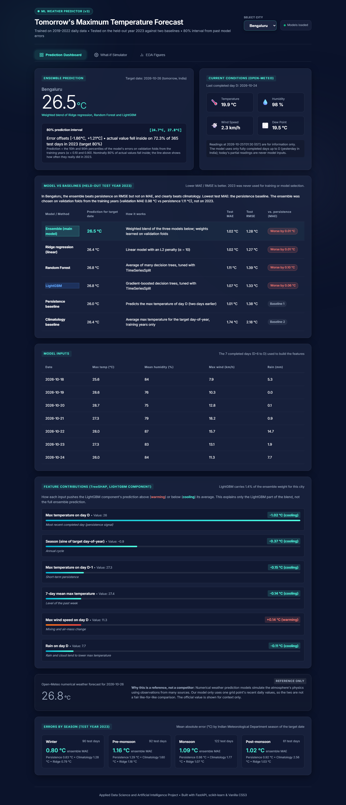
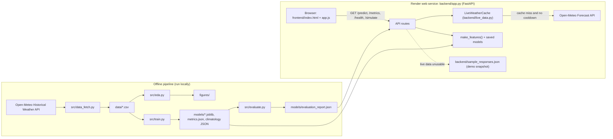

# ML Weather Predictor and Dashboard

**Applied Data Science and Artificial Intelligence (A.I.D.S.) — course project**

A web application that predicts **tomorrow's maximum temperature** for **Bengaluru, Delhi and Mumbai** from the last
seven completed days of weather data. It compares every prediction with two simple baselines, attaches an 80%
prediction interval whose real coverage was measured on a held-out year, and shows the official Open-Meteo forecast
separately as a reference.

- **Website:** <https://ml-weather-predictor-ae4j.onrender.com/>
- **Repository:** <https://github.com/bhavitha1917/ml-weather-predictor>
- **Detailed technical guide and viva preparation:** [PROJECT_DEEP_DIVE.md](PROJECT_DEEP_DIVE.md)
- **Audit of the current state (findings, evidence, open issues):** [PROJECT_AUDIT_REPORT.md](PROJECT_AUDIT_REPORT.md)

> **Current live-data status (last checked 26 Oct 2026, 04:00 IST):** the website is deployed and healthy (all models
> load), but the weather provider is rejecting the server's requests with **HTTP 429 – daily API request limit
> exceeded**. Until the limit resets, `/predict` returns a **saved demo snapshot** of an earlier real run
> (`data_source: "demo_snapshot"`, `fallback_reason: "rate_limited"`), and the dashboard shows a visible banner saying
> so. The snapshot is **not** today's forecast. See [Live data, cache and rate limits](#13-live-data-cache-and-rate-limits).



*Screenshot captured on 25 Oct 2026 from the local app with live data, before deployment (it still shows an older
"(v3)" label in the logo).*

---

## Contents
1. [Motivation and problem statement](#1-motivation-and-problem-statement)
2. [Scope and objectives](#2-scope-and-objectives)
3. [Implemented features](#3-implemented-features)
4. [Architecture](#4-architecture)
5. [Data](#5-data)
6. [ML pipeline: target, features, models and baselines](#6-ml-pipeline-target-features-models-and-baselines)
7. [Results](#7-results)
8. [Prediction interval](#8-prediction-interval)
9. [Exploratory data analysis](#9-exploratory-data-analysis)
10. [Technology stack](#10-technology-stack)
11. [Repository structure](#11-repository-structure)
12. [Setup, running and API](#12-setup-running-and-api)
13. [Live data, cache and rate limits](#13-live-data-cache-and-rate-limits)
14. [Testing](#14-testing)
15. [Deployment](#15-deployment)
16. [Limitations](#16-limitations)
17. [Future work](#17-future-work)
18. [Data sources and attribution](#18-data-sources-and-attribution)
19. [Viva and demo guide](#19-viva-and-demo-guide)

---

## 1. Motivation and problem statement

Daily maximum temperature matters for heat-stress planning, energy demand and everyday decisions. Numerical weather
prediction (NWP) models already forecast it well, so this project asks a narrower, testable question:

> Using only the last seven days of four daily variables at one location, can machine learning predict tomorrow's
> maximum temperature better than trivial forecasts, and how honestly can it state its own uncertainty?

The answer is reported as measured, including where the model does **not** beat the simplest baseline.

## 2. Scope and objectives

**In scope**
- Three cities (Bengaluru, Delhi, Mumbai), one target variable (daily maximum temperature at 2 m), one horizon.
- Five years of daily data (2019–2023): four years for training and validation, 2023 held out as the test year.
- Leakage-free features from one function shared by training and the live app.
- Comparison against a **persistence** and a **climatology** baseline, per city and per season, with MAE and RMSE.
- An 80% prediction interval with its coverage measured on the test year.
- A FastAPI backend and a dashboard, deployed as one web service.

**Out of scope (non-goals)**
- Replacing official forecasts. The Open-Meteo forecast is shown only as a reference, never as the model's output.
- Multi-day forecasts, other variables (rain, minimum temperature), or other cities.
- Automatic retraining or monitoring in production.

## 3. Implemented features

| Feature | Status |
|---|---|
| Tomorrow's max-temperature prediction per city from the last 7 completed days (live Open-Meteo data) | Implemented. Verified locally on 26 Oct 2026; **currently unavailable on the deployed site because of the provider's HTTP 429 limit** |
| Ensemble of LightGBM, Random Forest and Ridge with weights learned on validation folds | Implemented and verified |
| Persistence and climatology baselines, shown next to the model, with test-year MAE/RMSE | Implemented and verified |
| 80% prediction interval with its measured test-year coverage displayed next to it | Implemented and verified |
| Table of the 7 real input days used for the prediction | Implemented and verified |
| Current conditions and the official forecast for the target date, shown as reference only (missing values stay empty) | Implemented and verified |
| TreeSHAP contributions of the **LightGBM component only** (labelled with its ensemble weight) | Implemented; explains only a small part of the blend (see [Limitations](#16-limitations)) |
| Errors by season, EDA tab with 7 figures | Implemented |
| What-if simulator (synthetic inputs, clearly marked as not a forecast) | Implemented; illustrative only |
| Validated 30-minute in-memory cache, per-city request locks, HTTP 429 cooldown | Implemented and tested offline; deployed |
| Labelled demo-snapshot fallback when live data cannot be used | Implemented and verified on the deployed site |
| Optional Streamlit interface reusing the same backend code | Implemented; not deployed |

## 4. Architecture



One FastAPI process serves the dashboard (`/`, `/static/*`), the figures (`/figures/*`) and the JSON API from the same
origin, so no CORS configuration is needed.

## 5. Data

| Item | Value (verified from `data/*.csv` and `src/data_fetch.py`) |
|---|---|
| Source | Open-Meteo Historical Weather API (`archive-api.open-meteo.com`), downloaded by `src/data_fetch.py` |
| Cities (lat, lon) | Bengaluru (12.9716, 77.5946), Delhi (28.6139, 77.2090), Mumbai (19.0760, 72.8777): one grid point each |
| Period | 2019-01-01 to 2023-12-31, daily, local dates (`timezone=Asia/Kolkata`) |
| Columns | `date`, `temperature_2m_max` (°C), `relative_humidity_2m_mean` (%), `wind_speed_10m_max` (km/h), `precipitation_sum` (mm), `city` |
| Size | 1826 rows per city; no missing dates, no duplicate dates, no missing values (so no imputation) |

**Training vs. live data.** Training data come from the historical (reanalysis-based) archive; live inputs come from
the Open-Meteo **Forecast** API. A spot check for 14–19 Oct 2026 found daily maximum temperatures differ by at most
0.1–0.3 °C between the two, with identical humidity, wind and rain. Six days do not prove the sources match in general.

## 6. ML pipeline: target, features, models and baselines

**Target.** Let *D* be the last fully completed day in India (yesterday, IST). The target is the maximum temperature on
**D + 2**, which is tomorrow when the app runs today. Today's partial day is never an input. All dates are computed in
Indian Standard Time (UTC+05:30), never from the server clock.

**Features** (`src/features.py`, 22 columns, built only from days D−6 … D):
- max temperature on D, D−1 … D−6; its 7-day mean and standard deviation;
- day-to-day change (D − D−1) and the change in that change;
- mean humidity on D and D−1; an approximate dew point, max temperature − (100 − humidity)/5;
- max wind speed on D; rain on D, D−1 and the 3-day total;
- sine and cosine of the target date's day-of-year, plus a second (semi-annual) harmonic.

Three features are exact linear combinations of the temperature lags: the daily change, its change and the 7-day
mean. So the training matrix has rank 19 of 22 in every city, and the dew-point feature is also redundant once an
intercept is included. Tree models are unaffected. The linear model is Ridge regression, which handles collinearity
through regularisation.

**Pipeline.**
1. `src/data_fetch.py` downloads the data to `data/{city}.csv`.
2. `src/train.py`, per city:
   - builds features with `make_features()` and computes the climatology from **training years only**;
   - splits **by target date**: targets in 2019–2022 are training data (1453 rows), targets in 2023 the test set (365 rows);
   - tunes Random Forest and LightGBM (3 settings each) by 5-fold `TimeSeriesSplit` MAE on the training years; Ridge
     uses α = 10;
   - learns non-negative ensemble weights from out-of-fold (OOF) validation predictions;
   - computes the interval offsets (10th/90th percentiles of OOF ensemble errors);
   - refits on all training years, evaluates once on 2023, and saves the models and metrics.
3. `src/evaluate.py` re-evaluates the **saved** models and writes `models/evaluation_report.json`, which the API serves.

**Models and baselines**

| Name | Role | Detail |
|---|---|---|
| Persistence | Baseline | Prediction = max temperature on D (two days before the target) |
| Climatology | Baseline | Prediction = mean max temperature for the target's day-of-year over 2019–2022 |
| Ridge regression | Component model | Linear model with L2 penalty, α = 10, unscaled features (file `{city}_lr.joblib`, key `linear_regression`) |
| Random Forest | Component model | Bagged regression trees; best of 3 settings per city |
| LightGBM | Component model | Gradient-boosted trees; best of 3 settings per city |
| **Ensemble (served)** | Main model | Weighted sum of the three, weights ≥ 0 summing to 1, fitted on OOF predictions |

Ensemble weights (LightGBM / Random Forest / Ridge): Bengaluru 0.014 / 0.274 / 0.712, Delhi 0.000 / 0.256 / 0.744,
Mumbai 0.062 / 0.339 / 0.599. Ridge dominates the blend.

**Why the ensemble is the main model:** it has the lowest validation MAE (training years only) in every city:

| Validation MAE (°C) | Ensemble | Ridge | Random Forest | LightGBM | Persistence |
|---|---|---|---|---|---|
| Bengaluru | **0.981** | 0.990 | 1.043 | 1.068 | 1.115 |
| Delhi | **1.504** | 1.530 | 1.714 | 1.767 | 1.588 |
| Mumbai | **1.095** | 1.129 | 1.129 | 1.155 | 1.200 |

The blend weights were fitted on the same OOF predictions, so the ensemble's validation MAE is slightly optimistic.
The size of that bias has not been measured.

## 7. Results

Final test year **2023**, 365 days per city. Values from `models/metrics.json`, recomputed from the saved models by
`src/evaluate.py` (maximum difference 0.0) and again independently during the audit.

| MAE / RMSE (°C) | Ensemble | Ridge | Random Forest | LightGBM | Persistence | Climatology |
|---|---|---|---|---|---|---|
| Bengaluru | 1.024 / 1.280 | 1.021 / 1.274 | 1.115 / 1.385 | 1.075 / 1.335 | **1.010** / 1.376 | 1.737 / 2.177 |
| Delhi | **1.502 / 1.994** | 1.517 / 2.009 | 1.567 / 2.091 | 1.561 / 2.044 | 1.616 / 2.188 | 2.616 / 3.287 |
| Mumbai | 1.215 / 1.504 | 1.169 / **1.462** | 1.351 / 1.676 | 1.307 / 1.634 | **1.068** / 1.480 | 1.920 / 2.352 |

**What the results show**
- The ensemble beats **climatology** clearly in every city.
- Against **persistence** the result is mixed:
  - **Delhi:** better on both MAE and RMSE.
  - **Bengaluru:** better on RMSE but slightly worse on MAE.
  - **Mumbai:** worse on both.
- On the test year, persistence has the lowest MAE of all methods in Bengaluru and Mumbai.
- Two days ahead, maximum temperature changes slowly, so persistence is a strong baseline. Four daily variables at one
  grid point add little beyond the recent temperatures.
- 2023 was warmer than 2019–2022 by 0.90 °C (Bengaluru) and 1.12 °C (Mumbai), while Delhi was unchanged (−0.01 °C).
  The ensemble under-predicted on average by 0.34 °C, 0.02 °C and 0.52 °C (Bengaluru, Delhi, Mumbai).

Per-season results, residual plots and their interpretation are in [PROJECT_DEEP_DIVE.md](PROJECT_DEEP_DIVE.md#chapter-8-evaluation-and-interpretation).

## 8. Prediction interval

The method is in `src/intervals.py`. For a prediction ŷ the interval is **[ŷ + p10, ŷ + p90]**, rounded to 0.1 °C:
p10 and p90 are the 10th and 90th percentiles of the ensemble's out-of-fold errors (actual − predicted) on the
training years. Nominal coverage is 80%; 2023 was not used to choose the method.

| City | p10 / p90 (°C) | Coverage of displayed (rounded) bounds | Coverage with unrounded bounds | Approx. 95% range* |
|---|---|---|---|---|
| Bengaluru | −1.86 / +1.21 | **72.3%** | 69.6% | 67.7–76.9% |
| Delhi | −2.46 / +2.18 | **77.5%** | 77.3% | 73.3–81.8% |
| Mumbai | −1.52 / +2.03 | **81.1%** | 80.0% | 77.1–85.1% |

\*Normal approximation assuming independent days; daily errors are autocorrelated, so the true uncertainty is wider.

- **The 80% target is not achieved in Bengaluru.** Coverage is 72.3% for the displayed bounds and 69.6% for unrounded
  bounds, mainly because 2023 was warmer than the training years.
- **Delhi is slightly below 80%** and Mumbai about at it.
- **Seasonal coverage varies widely**, from 63.0% (Delhi, pre-monsoon) to 95.9% (Mumbai, monsoon).
- **Why rounding matters:** observations are recorded to 0.1 °C, so an actual value equal to a rounded bound counts as
  covered. That adds up to 2.7 percentage points.
- **Quantile models are not used.** `src/train.py` also trains LightGBM quantile models, but their test coverage was
  66.8 / 75.3 / 60.0%.

## 9. Exploratory data analysis

The figures are in `figures/` and in the dashboard's EDA tab. The numbers below were recomputed from `data/*.csv`
during the audit.

| Figure | Finding |
|---|---|
| 1 Distributions | Delhi's daily max ranges 12.9–45.4 °C; Mumbai's only 23.1–38.7 °C. Rain is heavily right-skewed. |
| 2 Seasons | Bengaluru and Mumbai are hottest in pre-monsoon (Mar–May). In Delhi, monsoon (Jun–Sep, 34.6 °C) and pre-monsoon (34.3 °C) have almost the same mean daily maximum, because June (38.3 °C) is Delhi's hottest month. Delhi's winter mean is only 20.8 °C. |
| 3 Correlations | Same-day Pearson correlation with max temperature: humidity −0.77 / −0.60 / −0.62 (Bengaluru / Delhi / Mumbai); rain −0.32 / −0.03 / −0.41; wind −0.23 / +0.35 / −0.05. Correlation is not causation. |
| 4 Raw autocorrelation | Stays high for weeks (Delhi 0.89 at lag 7, 0.70 at lag 30) because of the seasonal cycle, so it cannot choose a lag window by itself. |
| 5 City comparison | Mean daily max 28.8 / 30.2 / 30.4 °C; days per year with max ≥ 35 °C: 6 / 93 / 12. |
| 6 Day-to-day memory | After removing the day-of-year mean, autocorrelation falls from 0.75–0.84 (lag 1) to 0.24–0.38 (lag 7); partial autocorrelation is dominated by lag 1 (0.89–0.97). This supports a 7-day window as a reasonable choice, not a sharp cutoff. |
| 7 Residuals | Ensemble residuals on the 2023 test year per city, with the p10/p90 offsets. |

The EDA uses all five years, including 2023. It informed the 7-day window but no model parameters.

## 10. Technology stack

| Tool | Purpose in this project |
|---|---|
| Python 3.11.9 | Language and runtime (`.python-version`) |
| pandas, NumPy | Data loading, feature engineering |
| scikit-learn 1.9.1 | Random Forest, Ridge, `TimeSeriesSplit`, metrics |
| LightGBM 4.7.0 | Gradient-boosted trees; TreeSHAP contributions |
| joblib | Saving and loading model files |
| FastAPI, Uvicorn | Web API and static-file server |
| requests | Calls to the Open-Meteo APIs |
| HTML, CSS, plain JavaScript | Dashboard (no framework) |
| Matplotlib, seaborn | EDA and residual figures (development only) |
| pytest, httpx | Test suite and FastAPI test client (development only) |
| nbformat, nbclient, ipykernel | Building and executing the notebook (development only) |
| Streamlit | Optional alternative UI (development only, not deployed) |
| Render | Hosting (free web service defined in `render.yaml`) |

Runtime dependencies are pinned in `requirements.txt`. `requirements-dev.txt` adds the development tools.
scikit-learn and LightGBM must stay at the pinned versions, because the saved models were created with them.

## 11. Repository structure

```
├── backend/
│   ├── app.py                  # FastAPI app: routes, model loading, prediction pipeline, demo fallback
│   ├── live_data.py            # IST dates, Open-Meteo fetch, input-window validation, cache + 429 cooldown
│   └── sample_responses.json   # Demo snapshots: real responses captured on 25 Oct 2026
├── data/                       # bengaluru.csv, delhi.csv, mumbai.csv (training and test data)
├── docs/screenshots/           # Screenshots used in this README
├── figures/                    # EDA figures 1-6, residual plots per city, eda_summary.json
├── frontend/                   # index.html, style.css, app.js (dashboard)
├── models/
│   ├── {city}_ensemble|rf|lgb|lr.joblib   # Models used by the app ("lr" is the Ridge model)
│   ├── {city}_q10|q90.joblib   # Quantile models: trained and evaluated, NOT used by the app
│   ├── {city}_climatology.json # Day-of-year means from training years only
│   ├── metrics.json            # Written by src/train.py
│   └── evaluation_report.json  # Written by src/evaluate.py; served by /metrics and /predict
├── notebooks/weather_prediction_pipeline.ipynb   # Executed analysis notebook
├── scripts/
│   ├── create_notebook.py      # Builds (and with --execute, runs) the notebook
│   └── capture_demo_snapshots.py  # Refreshes the demo snapshots from a real live run
├── src/                        # data_fetch, eda, features, train, ensemble, intervals, evaluate
├── tests/                      # pytest suite (offline by default)
├── main.py                     # Local entry point: starts the server and opens a browser
├── streamlit_app.py            # Optional Streamlit UI
├── requirements.txt            # Runtime dependencies (installed by Render)
├── requirements-dev.txt        # Runtime + analysis, tests, notebook, Streamlit
├── render.yaml                 # Render Blueprint (one web service)
└── .python-version             # 3.11.9
```

## 12. Setup, running and API

**Local setup** (Python 3.11; tested with 3.11.9):

```bash
python -m venv .venv
# Windows: .venv\Scripts\activate      macOS/Linux: source .venv/bin/activate
pip install -r requirements-dev.txt     # or requirements.txt for the web app only
python main.py                          # http://127.0.0.1:8000, opens a browser
```

Alternatives: `uvicorn backend.app:app --port 8000` (server only) or `streamlit run streamlit_app.py`.

Optional environment variables (no secrets are needed):

| Variable | Purpose |
|---|---|
| `PORT`, `HOST` | Used by `main.py` (defaults `8000`, `127.0.0.1`) |
| `RENDER` | If set, `main.py` does not open a browser |
| `ALLOWED_ORIGINS` | Comma-separated origins for CORS. Not needed when the app serves its own dashboard (default: CORS off) |

**API** (interactive documentation at `/docs`):

| Endpoint | Behaviour |
|---|---|
| `GET /` | Dashboard |
| `GET /health` | `200` with `status`, `loaded_cities`, `artifact_errors`, `demo_snapshots_available`; `503` if any city's models failed to load |
| `GET /cities` | `["Bengaluru","Delhi","Mumbai"]` |
| `GET /predict?city=Delhi` | Prediction (`data_source` = `live`, `live_cached` or `demo_snapshot`). `400` unknown city; `503` models missing, or live data unusable with no snapshot; `500` internal error |
| `GET /metrics?city=Delhi` | Test-year metrics, validation MAE, served-interval coverage, `main_model_beats`, `best_model_by_test_mae` |
| `GET /simulate?city=…&temp_yesterday=…&humidity=…&wind_speed=…&temp_momentum=…` | Illustrative what-if output for a synthetic history (`is_illustrative: true`); not a forecast |

```bash
curl "https://ml-weather-predictor-ae4j.onrender.com/health"
curl "https://ml-weather-predictor-ae4j.onrender.com/predict?city=Delhi"
curl "https://ml-weather-predictor-ae4j.onrender.com/metrics?city=Mumbai"
```

Abridged real response, with live data, from a local run on 26 Oct 2026:

```json
{
  "city": "Delhi",
  "target_date": "2026-10-27",
  "last_completed_date": "2026-10-25",
  "generated_at": "2026-10-26T03:28:51+05:30",
  "data_source": "live",
  "weather_data_fetched_at": "2026-10-26T03:28:51+05:30",
  "predicted_temp": 29.4,
  "model_breakdown": {"ensemble": 29.4, "lightgbm": 29.4, "random_forest": 29.5, "linear_regression": 29.4},
  "interval_80": {"lower": 26.9, "upper": 31.6, "p10_offset": -2.46, "p90_offset": 2.18,
                  "nominal_coverage_pct": 80.0, "test_coverage_pct": 77.5, "test_days": 365},
  "persistence_baseline": 29.1,
  "climatology_baseline": 30.2,
  "official_forecast": {"temperature_max": 29.5, "date": "2026-10-27", "available": true},
  "is_demo_fallback": false
}
```

A second request within 30 minutes returned the same values with `"data_source": "live_cached"` and the same
`weather_data_fetched_at`.

## 13. Live data, cache and rate limits

**`data_source` values**

| Value | When it is returned |
|---|---|
| `live` | Open-Meteo was called for this request, and the 7-day window D−6 … D passed validation |
| `live_cached` | A validated Open-Meteo response for the same city and *D*, fetched less than 30 minutes ago, was reused. It is validated again on every request; `weather_data_fetched_at` is its fetch time |
| `demo_snapshot` | Live data could not be used. The response is a copy of a saved real run with its **original dates**, `is_demo_fallback: true`, `fallback_reason` and `fallback_message`. The dashboard shows a banner |

**How it works** (`LiveWeatherCache` in `backend/live_data.py`)
- **Only validated data is cached.** Failed requests and invalid data are never stored.
- **Cache key:** city, *D* and the request window (10 past days, 4 forecast days). A new Indian day therefore never
  reuses yesterday's data.
- **One request per city at a time:** concurrent requests for the same city wait for a single upstream call.
- **HTTP 429 handling:** after a 429, **no** request is sent to Open-Meteo for any city until the cooldown ends. The
  cooldown is the `Retry-After` value, or 15 minutes if the header is absent, capped at 24 hours. Meanwhile `/predict`
  returns the demo snapshot with `fallback_reason: "rate_limited"`.
- **Other failure reasons:** `timeout`, `upstream_error` (connection failure or other HTTP error), `malformed_response`,
  `missing_variable`, `insufficient_history` and `missing_values`.
- **The cache lives in memory.** It is lost on restart, and when the free Render instance sleeps.

**The caching does not bypass the provider's quota.** It only reduces how often this app calls Open-Meteo. If the
daily limit is exhausted, the app keeps showing the labelled demo snapshot until the provider accepts requests again.

**Observed incident (26 Oct 2026).**
- Render logs showed `Open-Meteo returned HTTP 429 … Daily API request limit exceeded. Please try again tomorrow.` for
  all three cities.
- The same requests succeeded from a local machine at the same time.
- Why the limit was exhausted on the server has **not** been independently established. Shared outgoing IP addresses
  on the hosting platform are a plausible explanation, not a proven one.

## 14. Testing

```bash
python -m pytest tests/                                        # offline: network calls are mocked or blocked
RUN_LIVE_TESTS=1 python -m pytest tests/ -k live_open_meteo    # optional: calls the real Open-Meteo API
```

Latest run (26 Oct 2026, Python 3.11.9, Windows): **132 collected, 129 passed, 0 failed, 3 skipped.** The 3 skipped
tests are the live-API smoke tests. With `RUN_LIVE_TESTS=1` they passed from a local machine on 26 Oct 2026.

| File (tests collected) | What it checks |
|---|---|
| `test_features.py` (22) | No leakage, correct lag dates, D+2 target, cyclical features, gap rejection, baselines, training-only climatology |
| `test_live_data.py` (29) | IST dates on a UTC server, input-window validation, HTTP 429/403/502, connection and timeout classification, safe log messages |
| `test_live_cache.py` (21) | Cache hits and expiry, failures never cached, `Retry-After` and default cooldown, concurrency, `live_cached` labelling |
| `test_predict_pipeline.py` (19) | `/predict` runs the real saved models on training-identical features; no invented values; labelled fallback; 503/500 paths |
| `test_api.py` (26) | Endpoints, city validation, metrics consistency, simulator, live smoke tests (skipped by default) |
| `test_evaluation.py` (15) | Interval and coverage arithmetic; saved metrics reproduce from the saved models |

There is no continuous integration; the tests are run manually.

## 15. Deployment

| Setting (`render.yaml`) | Value |
|---|---|
| Service | One free Python web service, `ml-weather-predictor` |
| Build command | `pip install -r requirements.txt` |
| Start command | `uvicorn backend.app:app --host 0.0.0.0 --port $PORT` |
| Python version | 3.11.9 (from `.python-version`) |
| Health check path | `/health` |

**Verified on the deployed site (26 Oct 2026)**
- **Models load on Render's Linux servers.** `/health` reports `healthy` with no artifact errors.
- **The read-only endpoints work:** `/`, `/cities`, `/metrics`, `/simulate` and `/docs`; an unknown city returns `400`.
- **Recent pushes went live within minutes.** In the two observed cases, a new commit on `main` was running within a
  few minutes. Whether that was an automatic deploy or a manual one was not checked.

**Free-tier behaviour.** Free instances sleep when idle, so the first request after a sleep is slow. Open `/health`
before a demo to wake the server. The in-memory cache starts empty after every wake-up or restart.

## 16. Limitations

**Model and evaluation**
- **Persistence is not consistently beaten.** The ensemble loses to persistence in Mumbai on both metrics and in
  Bengaluru on MAE.
- **The interval is not fully calibrated.** Coverage is 72.3% in Bengaluru against a nominal 80%.
- **One test year** of 365 autocorrelated days per city; season-level figures rest on 61–122 days each.
- **Slightly optimistic validation:** blend weights, hyperparameters and interval offsets all come from the same OOF
  predictions.
- **The models were trained on 2019–2022 and are used in 2026.** 2023 already showed a warm shift, and there is no
  retraining.
- **Tree models cannot extrapolate** above the temperatures they were trained on.

**Data**
- Five years of data; each season appears four times in training.
- One grid point per city, not a station.
- Reanalysis data for training versus forecast-model data for live inputs (spot-checked only).

**Technical and deployment**
- **Live data depends on a free third-party API** whose daily quota is currently exhausted on the server.
- **The cache is in memory** and lost on restart or sleep.
- **The demo snapshots are fixed** at 25 Oct 2026.
- **The explanation covers only LightGBM**, which has 0.0–6.2% of the blend weight, so it says little about the served
  prediction.
- **The what-if simulator is synthetic.** It builds an artificial history that is not even internally consistent, and
  it accepts out-of-range inputs.

**Ethical and practical**
- This is a student project, **not an official forecast**. It should not be used for safety decisions such as
  heatwave warnings.
- The dashboard shows the official forecast for comparison, and states clearly when it shows a demo snapshot.

## 17. Future work

Not implemented:
- **More data:** retrain on more years and refresh the models periodically.
- **Live-data reliability:** a persistent cache, a dedicated outgoing IP or a provider API key.
- **Better targets and inputs:** predict the change from D or the anomaly from climatology; add variables such as
  minimum temperature, cloud cover, radiation and pressure.
- **Interval calibration:** choose refinements on validation data (for example conformal or recency-weighted
  intervals), then re-test on a new period.
- **Explanations:** explain the full ensemble rather than only LightGBM.
- **Simulator:** validate its inputs and make its synthetic history internally consistent.
- **CI:** run the test suite automatically on each push.

## 18. Data sources and attribution

Weather data by [Open-Meteo.com](https://open-meteo.com/), licensed under
[CC BY 4.0](https://creativecommons.org/licenses/by/4.0/):
- **Training data:** the Historical Weather API. Open-Meteo's documentation describes it as built on reanalysis
  datasets such as ECMWF ERA5.
- **Live inputs, current conditions and the reference forecast:** the Forecast API.

The free API is intended for non-commercial use and enforces request limits; see Open-Meteo's terms.

## 19. Viva and demo guide

1. **Wake the server:** open `/health` a minute before the demo. It shows `healthy` and the three loaded cities.
2. **Open the dashboard and select a city.**
   - **No banner:** the prediction is live or `live_cached`. Explain the target date (tomorrow in India) and *D*.
   - **Banner:** say so plainly: *"The weather provider is rate-limiting the server, so this is a saved real run from
     25 Oct 2026, not today's forecast."*
3. **Walk through the cards:**
   - the prediction with its interval and measured coverage;
   - the model-vs-baselines table (point out where persistence wins);
   - the 7 input days;
   - the SHAP card, noting that it explains only LightGBM;
   - errors by season.
4. **EDA tab:** seasonality, the correlations, and the lag-window evidence in figure 6.
5. **API:** show `/docs`, then `/predict?city=Delhi` and the `data_source` / `fallback_reason` fields.
6. **Close:** honest evaluation against baselines, measured uncertainty, a leakage-free shared feature pipeline, and
   tested failure handling. Then name the limitations and future work above.

The full question bank (35+ questions with answers) and a step-by-step demo script are in
[PROJECT_DEEP_DIVE.md](PROJECT_DEEP_DIVE.md#chapter-15-viva-preparation).
