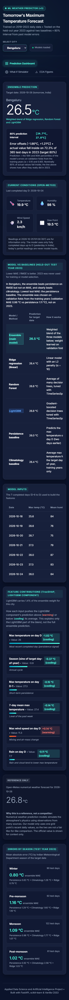
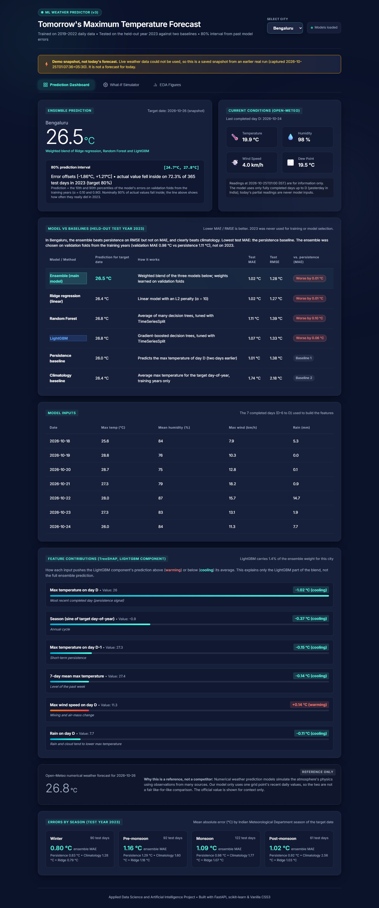

# ML Weather Predictor and Dashboard

**Applied Data Science and Artificial Intelligence — course project**

A web application that predicts **tomorrow's maximum temperature** for **Bengaluru, Delhi and Mumbai** from recent
daily weather, compares the prediction with two simple baselines, shows an 80% prediction interval whose real
coverage has been measured, and displays the official numerical weather forecast separately as a reference.

> **Deployment status: pending.** The app runs locally and has been verified end to end on a laptop
> (see [Testing](#13-testing) and [Deployment](#16-deployment)). There is no public URL yet.


---

## Contents
1. [Problem and objectives](#1-problem-and-objectives)
2. [Features](#2-features)
3. [Technologies](#3-technologies)
4. [Project structure](#4-project-structure)
5. [Data](#5-data)
6. [Exploratory data analysis](#6-exploratory-data-analysis)
7. [Forecast target and features](#7-forecast-target-and-features)
8. [Models, training and validation](#8-models-training-and-validation)
9. [Results](#9-results)
10. [Prediction interval](#10-prediction-interval)
11. [Architecture and API](#11-architecture-and-api)
12. [Installation and running locally](#12-installation-and-running-locally)
13. [Testing](#13-testing)
14. [Reproducing the analysis](#14-reproducing-the-analysis)
15. [Limitations](#15-limitations)
16. [Deployment](#16-deployment)
17. [Future improvements](#17-future-improvements)

---

## 1. Problem and objectives

Predict the maximum temperature for tomorrow in three Indian cities using only recent daily observations, and judge
honestly whether machine learning adds value over trivial forecasts.

Objectives (from the course project blueprint, which is not included in this repository):
- Collect five years of daily weather data and analyse it (EDA).
- Build features without data leakage, with one feature function shared by training and the live app.
- Train one model per city, validate with `TimeSeriesSplit`, and test once on a held-out final year.
- Compare against a **persistence** and a **climatology** baseline with MAE and RMSE, per city and per season.
- Provide an 80% prediction interval and check its coverage on the test year.
- Serve live predictions through a FastAPI backend and a dashboard.

## 2. Features

- Live prediction for each city, built from the last 7 completed days fetched from Open-Meteo.
- **80% prediction interval** with its measured test-year coverage shown next to it.
- **Model vs. baselines table** with test-year MAE/RMSE; whether each model beats persistence is computed from the
  metrics, not hard-coded.
- **Model inputs table**: the 7 real observed days the prediction used.
- Current conditions and the official Open-Meteo forecast for the target date, shown as **reference only**.
  A missing value is shown as unavailable, never invented.
- TreeSHAP feature contributions of the LightGBM component (labelled as such, with its blend weight).
- Errors by season, an EDA tab with 7 figures, and an **illustrative** what-if simulator (clearly marked as not a forecast).
- Loading, error and **demo-snapshot** states: if live weather data cannot be used, the app shows a saved snapshot of an
  earlier real run with its original dates and a visible banner. It never presents it as today's forecast.
- Optional Streamlit interface (`streamlit_app.py`) that reuses the same backend pipeline.

| Mobile | Demo snapshot banner |
|---|---|
|  |  |

Screenshots were captured on 25 Oct 2026 from the local app (live Open-Meteo data, and the demo state forced by
simulating a weather-service failure).

## 3. Technologies

| Purpose | Tools |
|---|---|
| Data and analysis | pandas, NumPy, Matplotlib, seaborn |
| Machine learning | scikit-learn (Random Forest, Ridge), LightGBM, joblib |
| Backend | FastAPI, Uvicorn, requests |
| Frontend | HTML, CSS and plain JavaScript (no framework), Inter font |
| Alternative UI | Streamlit |
| Tests and notebook | pytest, httpx (FastAPI test client), nbclient/ipykernel |
| Data source | Open-Meteo Historical Weather API (training) and Forecast API (live), free, no API key |

Python 3.11.9 was used. Library versions are pinned (see [Installation](#12-installation-and-running-locally)).

## 4. Project structure

```
weather_predictor_project/
├── backend/
│   ├── app.py                  # FastAPI app: /health /cities /predict /metrics /simulate, serves the frontend
│   ├── live_data.py            # Indian-time forecast dates, Open-Meteo fetch, validation of the 7-day input window
│   └── sample_responses.json   # Demo snapshots captured from a real run (used only if live data fails)
├── data/                       # bengaluru.csv, delhi.csv, mumbai.csv (2019-01-01 .. 2023-12-31, 1826 rows each)
├── docs/screenshots/           # Screenshots used in this README
├── figures/                    # EDA figures 1-6, residual plots per city, eda_summary.json
├── frontend/                   # index.html, style.css, app.js (dashboard)
├── models/
│   ├── {city}_ensemble|rf|lgb|lr.joblib   # Trained models used by the app
│   ├── {city}_q10|q90.joblib   # LightGBM quantile models (trained, evaluated, NOT used by the app)
│   ├── {city}_climatology.json # Day-of-year means from training years only
│   ├── metrics.json            # Test-year metrics and interval offsets written by src/train.py
│   └── evaluation_report.json  # Verified re-evaluation written by src/evaluate.py
├── notebooks/weather_prediction_pipeline.ipynb   # Executed analysis notebook
├── scripts/
│   ├── create_notebook.py      # Builds and executes the notebook
│   └── capture_demo_snapshots.py  # Captures real responses for the demo fallback
├── src/
│   ├── data_fetch.py           # Downloads the historical data
│   ├── eda.py                  # EDA figures and diagnostics
│   ├── features.py             # make_features(): shared by training and the live app
│   ├── train.py                # Tuning, training, interval offsets, metrics, residual plots
│   ├── ensemble.py             # Weighted blend of LightGBM, Random Forest and Ridge
│   ├── intervals.py            # The 80% interval and coverage calculation
│   └── evaluate.py             # Reproducible re-evaluation of the saved models
├── tests/                      # pytest suite (offline; network calls are mocked)
├── main.py                     # Local entry point (starts the server, opens the browser)
├── streamlit_app.py            # Optional Streamlit UI
├── requirements.txt            # Runtime dependencies (what a server needs)
├── requirements-dev.txt        # + analysis, tests, notebook, Streamlit
├── render.yaml                 # Render Blueprint for the single web service
└── .python-version             # 3.11.9
```

## 5. Data

| Item | Value |
|---|---|
| Source | Open-Meteo Historical Weather API (`archive-api.open-meteo.com`) via `src/data_fetch.py` |
| Cities (lat, lon) | Bengaluru (12.9716, 77.5946), Delhi (28.6139, 77.2090), Mumbai (19.0760, 72.8777) |
| Period | 2019-01-01 to 2023-12-31, daily, local dates (`timezone=Asia/Kolkata`) |
| Variables | `temperature_2m_max` (°C), `relative_humidity_2m_mean` (%), `wind_speed_10m_max` (km/h), `precipitation_sum` (mm) |
| Size | 1826 rows per city |

**Cleaning and validation.** Every city has 1826 consecutive dates with **no missing dates, no duplicate dates and no
missing values**, so no imputation was needed. `make_features()` additionally refuses data with gaps or duplicate dates,
because lag features are row shifts and a gap would silently misalign them.

**Live data.** The app uses the Open-Meteo **Forecast** API with `past_days=10`. Training data is reanalysis data
while live inputs come from a forecast model. A spot check of 14–19 Oct 2026 found the two sources' daily maximum
temperatures differ by at most 0.3 °C, with identical humidity.

## 6. Exploratory data analysis

Figures are in `figures/` and shown in the dashboard's EDA tab; the notebook computes every number below.

| Figure | What it shows |
|---|---|
| 1 Distributions | Delhi has by far the widest temperature range; Mumbai the narrowest. Rain is heavily skewed. |
| 2 Seasons | Pre-monsoon (Mar–May) is the hottest season everywhere; Delhi varies most between seasons. |
| 3 Correlations | Same-day Pearson correlation with max temperature: humidity −0.77 / −0.60 / −0.62 (Bengaluru / Delhi / Mumbai); rain −0.32 / **−0.03** / −0.41; wind −0.23 / +0.35 / −0.05. Correlation is not causation. |
| 4 Raw autocorrelation | Stays high for weeks (Delhi 0.89 at lag 7, 0.70 at lag 30) because of the seasonal cycle, so it cannot choose a lag window by itself. |
| 5 City comparison | Mean max temperature, range and hot days (≥ 35 °C) per year. |
| 6 Day-to-day memory | After removing the day-of-year mean, autocorrelation falls from 0.75–0.84 (lag 1) to 0.24–0.38 (lag 7); partial autocorrelation is dominated by lag 1. A 7-day window is a reasonable choice, not a sharp cutoff. |

## 7. Forecast target and features

**Target.** Let *D* be the last fully completed day in India (yesterday). The target is the maximum temperature on
**D + 2**, which is tomorrow when the app runs today. Today's partial day is never used, so live inputs match training
inputs. All dates are computed in Indian time (UTC+05:30), not from the server clock.

**Features** (`src/features.py`, 22 columns, built only from days up to *D*):
- maximum temperature on D, D−1 … D−6, and its 7-day mean and standard deviation;
- change from D−1 to D, and the change in that change;
- mean humidity on D and D−1; an approximate dew point (max temperature − (100 − humidity)/5);
- maximum wind speed on D; rain on D, D−1 and the 3-day total;
- sine and cosine of the target date's day-of-year, plus a second (semi-annual) harmonic.

Three features (daily change, its change and the approximate dew point) are exact linear combinations of others, so
the feature matrix has rank 19 of 22. Trees are unaffected. For a linear model it means ordinary least squares has no
unique solution, which is why the linear model is Ridge regression.

**Baselines.** *Persistence*: the max temperature on D (two days before the target). *Climatology*: the average max
temperature for the target's day-of-year over the training years only.

**Leakage prevention.** Features for a date are identical whether or not later data exists (tested for every city).
The climatology uses training years only, the split is chronological, and the live app validates that the 7 input days
are exactly D−6 … D.

## 8. Models, training and validation

- One set of models per city, data sorted by date.
- **Split by target date:** targets in 2019–2022 are training data (1453 rows); targets in **2023** are the final test
  set (365 rows), used once for the final evaluation.
- **Validation:** 5-fold `TimeSeriesSplit` inside the training years (each fold trains on the past and validates on the
  next block).
- **Models:**
  - Random Forest: 3 hyperparameter settings compared on validation MAE.
  - LightGBM: 3 settings compared the same way.
  - Ridge regression (α = 10).
  - **Ensemble (main model):** a non-negative weighted blend of the three. The weights are fitted on out-of-fold
    validation predictions (Bengaluru LGB/RF/Ridge = 0.01/0.27/0.71, Delhi 0.00/0.26/0.74, Mumbai 0.06/0.34/0.60).
- Final models are refit on all training years and saved with joblib.

**Deviation from the blueprint.** The blueprint names Linear Regression and Random Forest. The implementation uses
Ridge regression as the linear model and adds LightGBM and the ensemble. On the training-years validation folds,
unregularised linear regression was worse than Ridge in every city. Ridge is applied to unscaled features; scaling
changed the validation MAE by at most 0.02 °C, so the saved models were not retrained.

**Why the ensemble is the main model.** It has the lowest validation MAE in every city. This choice did not use 2023.

| Validation MAE (°C, training years) | Ensemble | Ridge | Random Forest | LightGBM | Persistence |
|---|---|---|---|---|---|
| Bengaluru | **0.981** | 0.990 | 1.043 | 1.068 | 1.115 |
| Delhi | **1.504** | 1.530 | 1.714 | 1.767 | 1.588 |
| Mumbai | **1.095** | 1.129 | 1.129 | 1.155 | 1.200 |

## 9. Results

Test year 2023, 365 days per city. Lower is better. Recomputed from the saved models by `src/evaluate.py` and
identical to `models/metrics.json`.

| MAE / RMSE (°C) | Ensemble | Ridge | Random Forest | LightGBM | Persistence | Climatology |
|---|---|---|---|---|---|---|
| Bengaluru | 1.024 / 1.280 | 1.021 / 1.274 | 1.115 / 1.385 | 1.075 / 1.335 | **1.010** / 1.376 | 1.737 / 2.177 |
| Delhi | **1.502 / 1.994** | 1.517 / 2.009 | 1.567 / 2.091 | 1.561 / 2.044 | 1.616 / 2.188 | 2.616 / 3.287 |
| Mumbai | 1.215 / 1.504 | 1.169 / **1.462** | 1.351 / 1.676 | 1.307 / 1.634 | **1.068** / 1.480 | 1.920 / 2.352 |

**Interpretation**
- The ensemble **beats climatology clearly in every city**.
- **Against persistence the result is mixed:**
  - Delhi: better on both MAE and RMSE.
  - Bengaluru: better on RMSE (fewer large errors) but not on MAE.
  - Mumbai: worse on both.
- Ridge alone performs about as well as the ensemble. The Random Forest, the blueprint's main model, does not beat
  persistence on MAE in Bengaluru or Mumbai.
- Persistence is a strong baseline two days ahead because maximum temperature changes slowly. These results suggest the
  four daily variables at one location add little information beyond the recent temperatures. A small or negative gain
  is still a valid, honestly reported finding.
- 2023 was about 0.9 °C (Bengaluru) and 1.1 °C (Mumbai) warmer than 2019–2022 on average, while Delhi's 2023 was not.
  Accordingly, the ensemble under-predicted by +0.34 °C and +0.52 °C on average in Bengaluru and Mumbai, but only
  +0.02 °C in Delhi.

**Per season** (ensemble MAE in °C, with persistence in brackets; 61–122 days each):

| | Winter | Pre-monsoon | Monsoon | Post-monsoon |
|---|---|---|---|---|
| Bengaluru | 0.80 (0.83) | 1.16 (1.29) | 1.10 (0.98) | 1.02 (0.92) |
| Delhi | 1.44 (1.61) | 2.07 (2.15) | 1.39 (1.51) | 0.96 (1.02) |
| Mumbai | 1.55 (1.58) | 1.28 (1.01) | 0.83 (0.81) | 1.40 (0.92) |

Delhi's pre-monsoon is hardest to predict. Residual plots: `figures/residuals_{city}.png`.

## 10. Prediction interval

**Method** (`src/intervals.py`):
1. Collect the ensemble's out-of-fold errors (actual − predicted) on the training-years validation folds.
2. Take their 10th and 90th percentiles, p10 and p90.
3. For a new prediction ŷ, the interval is **[ŷ + p10, ŷ + p90]**, rounded to 0.1 °C.

Nominally, 80% of actual values should fall inside. The test year was not used to choose this method.

**Measured coverage** on the 2023 test year, for exactly the interval the app shows:

| City | p10 / p90 (°C) | Coverage | Approx. 95% range* | By season (Winter / Pre-monsoon / Monsoon / Post-monsoon) |
|---|---|---|---|---|
| Bengaluru | −1.86 / +1.21 | **72.3%** | 67.7–76.9% | 82.2 / 69.6 / 70.5 / 65.6% |
| Delhi | −2.46 / +2.18 | **77.5%** | 73.3–81.8% | 77.8 / 63.0 / 81.1 / 91.8% |
| Mumbai | −1.52 / +2.03 | **81.1%** | 77.1–85.1% | 70.0 / 72.8 / 95.9 / 80.3% |

\*Normal approximation assuming independent days. Daily errors are autocorrelated, so the true uncertainty is wider.

**Notes**
- Delhi and Mumbai are close to 80%. **Bengaluru is clearly below 80%**, mainly because of the warmer-2023 bias above:
  the interval assumes future errors resemble past errors.
- **Rounding matters here.** The coverage above is for the bounds as displayed: rounded to 0.1 °C and inclusive.
  Observations are also recorded to 0.1 °C, so an actual value that equals a rounded bound counts as covered. With
  unrounded bounds (the same p10/p90), coverage is **69.6 / 77.3 / 80.0%**: 2.7 points lower for Bengaluru,
  0.2 for Delhi and 1.1 for Mumbai. `src/train.py` printed 69.6 / 77.3 / 79.7% using p10/p90 before they were rounded
  to two decimals. The Bengaluru gap is material, and both figures are below the nominal 80%.
- `src/train.py` also trains LightGBM quantile models (α = 0.1/0.9). Their test coverage was 66.8 / 75.3 / 60.0%, so
  **they are not used by the app**. (An earlier version of the app displayed them.)

## 11. Architecture and API

```
Offline:  Open-Meteo Archive API -> data/*.csv -> src/eda.py (figures)
                                             -> src/train.py (models/*.joblib, metrics.json)
                                             -> src/evaluate.py (evaluation_report.json)
Online:   browser -> FastAPI (backend/app.py) -> Open-Meteo Forecast API (past 10 days + forecast)
                     -> validate days D-6..D -> make_features() -> saved models -> JSON -> dashboard
```

The same FastAPI app serves the dashboard (`/`, `/static/*`), the figures (`/figures/*`) and the API, so the
frontend calls the API on the same origin. Interactive documentation is at `/docs`.

| Endpoint | Description |
|---|---|
| `GET /health` | `200` with loaded cities when all model files loaded; `503` with the loading errors otherwise. Also used to wake a sleeping server. |
| `GET /cities` | `["Bengaluru", "Delhi", "Mumbai"]` |
| `GET /predict?city=Delhi` | Live prediction (details below). `400` for an unknown city; `503` if models are missing or if live data fails and no demo snapshot exists; `500` for internal errors (details only in the server log). |
| `GET /metrics?city=Delhi` | Saved test-year metrics (`overall`, `by_season`, `interval_80`, …) plus the verified `served_interval` coverage, `validation` MAE and `main_model_beats`. |
| `GET /simulate?city=…&temp_yesterday=…&humidity=…&wind_speed=…&temp_momentum=…` | Illustrative only: model outputs for a synthetic 7-day history built from the sliders (`is_illustrative: true`). |

**`/predict` behaviour**
1. Compute *D* and the target date in Indian time.
2. Fetch Open-Meteo data and check that D−6 … D are all present and numeric.
3. Build the features with `make_features()` and predict with the ensemble.
4. Add the interval, both baselines, current conditions and the official forecast for exactly the target date.

If the weather service fails or its data is incomplete, the response is a copy of a saved snapshot of an earlier real
run, with `is_demo_fallback: true`, `data_source: "demo_snapshot"`, `fallback_reason` and its original dates.

Example (abridged, real response captured on 25 Oct 2026):

```json
{
  "city": "Delhi",
  "target_date": "2026-10-26",
  "last_completed_date": "2026-10-24",
  "data_source": "live",
  "predicted_temp": 30.3,
  "model_breakdown": {"ensemble": 30.3, "lightgbm": 29.8, "random_forest": 29.5, "linear_regression": 30.6},
  "interval_80": {"lower": 27.9, "upper": 32.5, "p10_offset": -2.46, "p90_offset": 2.18,
                  "nominal_coverage_pct": 80.0, "test_coverage_pct": 77.5, "test_days": 365},
  "persistence_baseline": 30.9,
  "climatology_baseline": 29.9,
  "current_conditions": {"observed_at": "2026-10-25T01:00", "temperature": 22.1, "humidity": 71,
                         "wind_speed": 6.0, "dew_point": 16.5},
  "official_forecast": {"temperature_max": 30.3, "date": "2026-10-26", "available": true},
  "input_window": [{"date": "2026-10-18", "temperature_2m_max": 29.4, "...": "..."}],
  "is_demo_fallback": false
}
```

## 12. Installation and running locally

Requires Python 3.11 (tested with 3.11.9).

```bash
python -m venv .venv
# Windows: .venv\Scripts\activate      macOS/Linux: source .venv/bin/activate
pip install -r requirements-dev.txt     # or requirements.txt for the web app only
python main.py                          # http://127.0.0.1:8000, opens the browser
```

Alternatives:
- Run the server only: `uvicorn backend.app:app --port 8000`
- Streamlit interface: `streamlit run streamlit_app.py`

`scikit-learn==1.9.1` and `lightgbm==4.7.0` are the versions the saved models were created with. Other versions may
fail to load them or change their predictions.

Environment variables (all optional):

| Variable | Purpose |
|---|---|
| `PORT`, `HOST` | Used by `main.py` (defaults `8000`, `127.0.0.1`) |
| `RENDER` | If set, `main.py` does not try to open a browser |
| `ALLOWED_ORIGINS` | Comma-separated origins allowed by CORS. Not needed when the dashboard is served by the app itself (default: CORS off) |

## 13. Testing

```bash
python -m pytest tests/                       # offline: all network calls are mocked or blocked
RUN_LIVE_TESTS=1 python -m pytest tests/ -k live_open_meteo   # optional smoke test against the real Open-Meteo API
```

Last local run (25 Oct 2026, Python 3.11.9): **99 passed, 3 skipped** (the 3 skipped are the optional live tests).
The 3 live tests also passed when run with `RUN_LIVE_TESTS=1`.

| File | What it checks |
|---|---|
| `test_features.py` | No leakage (features unchanged when future rows are removed, all cities); lags and rolling windows use the intended dates; target is D+2; cyclical features use the target date; gaps are rejected; baselines and training-only climatology |
| `test_live_data.py` | Indian-time dates on a UTC server (around midnight IST); the 7-day window excludes today and forecast rows; missing middle or recent dates, missing values, missing variables and malformed responses all raise errors instead of shifting the forecast |
| `test_predict_pipeline.py` | `/predict` runs the real models and equals the saved ensemble applied to the training-time feature row; served interval equals the evaluated one; official forecast and current conditions are never invented; weather-service failures give a labelled, unmodified demo snapshot; missing models give `503`, internal errors give `500` |
| `test_api.py` | Health, cities, invalid cities on every endpoint, frontend-facing fields, metrics consistency, simulator |
| `test_evaluation.py` | Interval and coverage arithmetic; saved metrics and the evaluation report reproduce exactly from the saved models |

## 14. Reproducing the analysis

```bash
python -m src.data_fetch                    # re-download data (overwrites data/*.csv)
python -m src.eda                           # figures 1-5 and eda_summary.json
python -c "from src.eda import plot_memory_diagnostics; plot_memory_diagnostics()"   # figure 6
python -m src.train                         # retrain all models, metrics.json, residual plots
python -m src.evaluate                      # verify saved models -> models/evaluation_report.json
python scripts/create_notebook.py --execute # rebuild and run the notebook
python scripts/capture_demo_snapshots.py    # refresh demo snapshots (needs internet)
```

The notebook `notebooks/weather_prediction_pipeline.ipynb` has been executed and contains computed outputs for data
validation, EDA, lag-window diagnostics, the leakage check, the split, model comparison, seasonal errors, residuals
and interval coverage. Its last section is reserved for the team's own notes.

## 15. Limitations

- **Data:** only three cities and one variable, and five years of data (four for training): each season is seen only
  four times.
- **Spatial coverage:** a single grid point per city, not a weather station.
- **Training vs. live data:** training uses reanalysis data, but live inputs come from a forecast model (small
  differences; see [Data](#5-data)).
- **The deployed models are trained on 2019–2022.** They are being used in 2026, and 2023 already shows a warm shift.
- **The ensemble does not consistently beat persistence** on the test year.
- **The interval** assumes future errors look like past errors. Coverage was 72% in Bengaluru, not 80%.
- **Extrapolation:** tree models cannot predict above the highest temperature they were trained on.
- **Small test sample:** one test year is 365 autocorrelated days.
- **What-if simulator:** it uses synthetic, unrealistic histories (fixed pattern, no rain) and is for illustration only.
- **SHAP:** the explanations cover only the LightGBM component, which has a small weight in the blend.
- **Demo snapshots:** they become stale over time. They are shown with their original dates and a banner.

## 16. Deployment

**Status: not deployed; no public URL exists yet.**

The app is a **single web service** that serves both the API and the dashboard from the same origin. `render.yaml`
describes it as a Render free web service:

| Setting | Value |
|---|---|
| Build command | `pip install -r requirements.txt` |
| Start command | `uvicorn backend.app:app --host 0.0.0.0 --port $PORT` |
| Python version | 3.11.9 (from `.python-version`) |
| Health check path | `/health` (returns 503 if any city's models failed to load) |

**Notes**
- The app has been verified on Windows only. Loading the models and serving requests on Render's Linux servers has
  not been tested yet.
- `models/`, `figures/`, `data/` and `backend/sample_responses.json` must be in the repository: the app reads them at
  startup.
- Free instances sleep when idle. The first request after a sleep can take about a minute; the dashboard shows a
  loading message. Open `/health` before a demo to wake the server.

## 17. Future improvements

- Retrain on more years (the archive goes back decades) and refresh the models periodically.
- Predict the change from day D, or the anomaly from climatology, and add variables such as minimum temperature,
  cloud cover, radiation and pressure. Evaluate any change on validation folds first.
- Choose interval-calibration refinements on validation data (for example, excluding the first, shortest CV fold, or
  recalibrating on recent errors), then re-check coverage on a new test period.
- Explain the full ensemble prediction (not only LightGBM).
